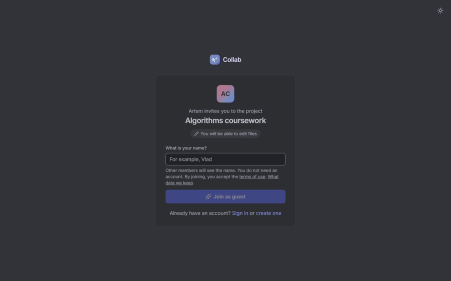
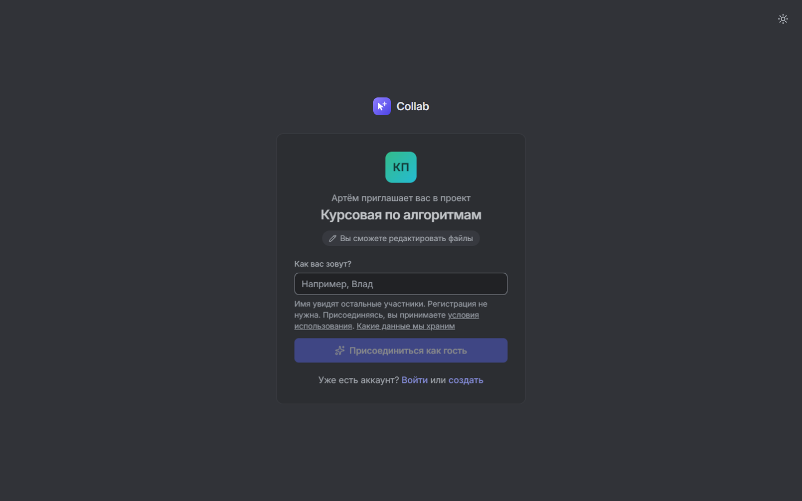
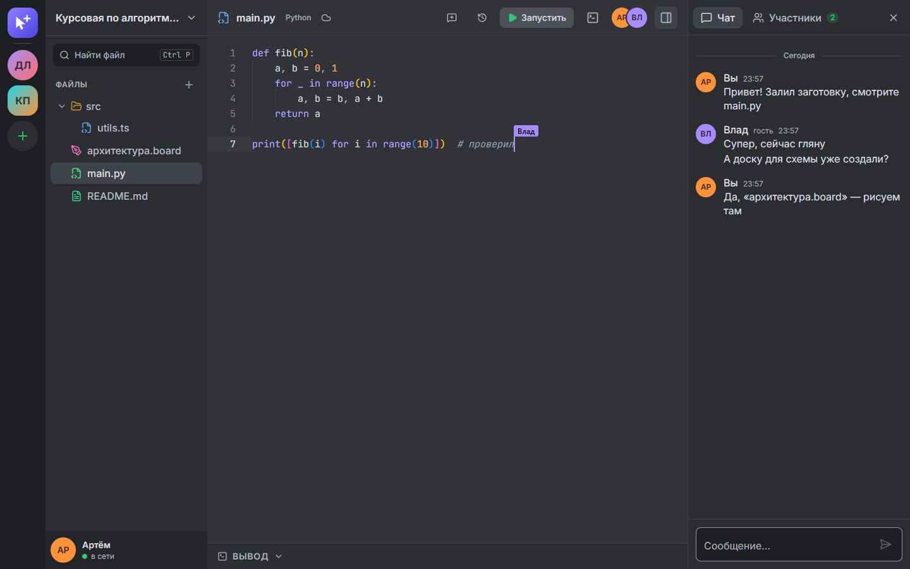
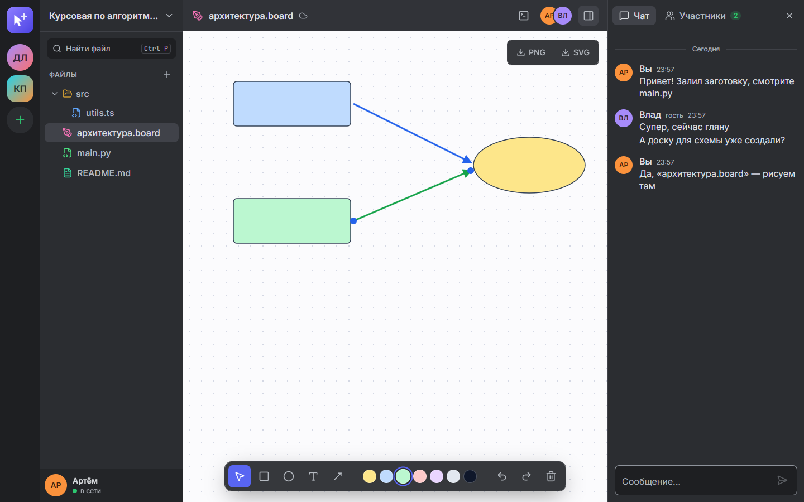

# Collab Code Platform

[Русская версия](README.md)

A web platform for editing code together in real time, based on CRDT (Yjs). Send a link, and the other
person is in your project in seconds: no account and nothing to install.

It is a diploma project: a working platform and a study that compares CRDT and OT by latency,
correctness and scalability.



## What it does

- **Join by link.** A guest opens the invitation link, enters a name and starts to edit. No registration.
- **Edit together.** Several people type in the same file at the same time and see each other's cursors.
- **One project, not one file.** Code files, Markdown documents with a live preview, a whiteboard and a
  project chat live in one place and stay there after the session.
- **Run code together.** JavaScript and Python run in a closed sandbox, and everyone sees the same output.
- **Work during a connection break.** Edits made offline are kept on the device and merge automatically
  when the connection is back.
- **GitHub.** Import a public repository by its link and send changes back as a commit.
- **Start from an example.** A new project can begin with a short guide and a file that is ready to run.

| The invitation page | The shared editor | The whiteboard |
|---|---|---|
|  |  |  |

The interface is in Russian.

## Repository layout

```
├── apps/
│   ├── web/        React SPA (Vite, Monaco, Yjs, react-konva), PWA, invitation links, guest entry
│   ├── api/        Fastify REST + Swagger + auth + projects + files
│   ├── collab/     Hocuspocus, Yjs synchronisation, access rights
│   └── runner/     BullMQ worker, runs code in a Docker sandbox
├── packages/
│   ├── shared/     Types, Zod schemas, constants
│   └── db/         Prisma schema and migrations
├── bench/          CRDT vs OT test bench: scenarios, results, charts
├── e2e/            Playwright: end-to-end tests in two browsers
├── infra/          Dockerfile, docker-compose, Caddyfile, deployment scripts
├── docs/           ADRs, WebSocket protocol, deployment, database, UX, thesis text
└── .github/workflows/
```

## Local development

You need Node.js 20+, pnpm (`corepack enable`) and Docker.

```bash
pnpm install
docker compose -f infra/docker-compose.dev.yml up -d   # Postgres :5433, Redis :6380
cp apps/api/.env.example apps/api/.env
cp apps/collab/.env.example apps/collab/.env
cp apps/web/.env.example apps/web/.env
cp packages/db/.env.example packages/db/.env
pnpm db:migrate
pnpm dev:api      # REST API, http://localhost:3001, Swagger at /docs
pnpm dev:collab   # sync server, ws://localhost:1234
pnpm dev:runner   # code execution (needs Docker)
pnpm dev:web      # web app, http://localhost:5173
```

Sign in with e-mail and password, through a project's invitation link (the owner sees it on the project
page), or without registration with the "Продолжить как гость" button on the sign-in page.

## Scripts

- `pnpm lint` / `pnpm typecheck` / `pnpm test` — in all packages
- `pnpm db:generate` / `pnpm db:migrate` — Prisma
- `pnpm db:schema-sql` — build the full DDL from the schema into `docs/db/schema.sql`
- `pnpm --filter @collab/e2e e2e` — end-to-end tests (need Postgres, Redis and Chrome; with
  `E2E_RUNNER=1` and a running runner they also run code)
- `pnpm --filter @collab/bench bench` — the CRDT vs OT bench (results in `bench/results/REPORT.md`)

## Documentation

Most documents are in Russian.

- [docs/db](docs/db) — database: data dictionary, ER diagram, migrations and DDL
- [docs/ux](docs/ux) — UX specification: scenarios with errors, visual style, components, screens (PDF)
- [docs/ba](docs/ba) — business analysis (in English)
- [docs/adr](docs/adr) — architecture decision records
- [docs/websocket-protocol.md](docs/websocket-protocol.md) — real-time protocols
- [docs/deploy-local.md](docs/deploy-local.md), [docs/deploy-gcp.md](docs/deploy-gcp.md),
  [docs/deploy-aws.md](docs/deploy-aws.md) — deployment
- [docs/thesis](docs/thesis) — drafts of the thesis chapters
- Swagger — `http://localhost:3001/docs` when the API is running

## Stack

TypeScript everywhere. React + Vite on the front end, Fastify on the back end, Hocuspocus for Yjs
synchronisation, PostgreSQL (Prisma) and Redis (BullMQ) for data and queues, Docker for running code in
isolation. Details and alternatives are in [docs/adr](docs/adr).
