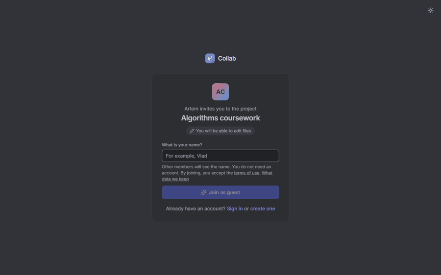
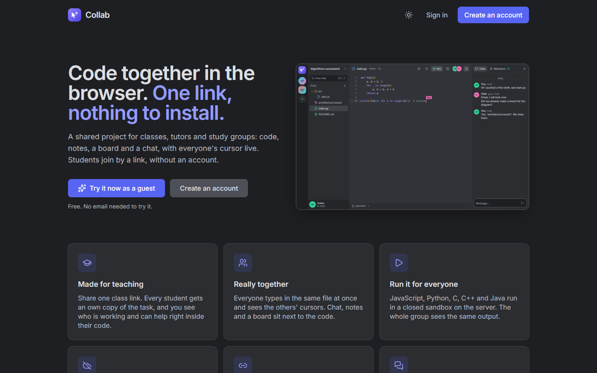
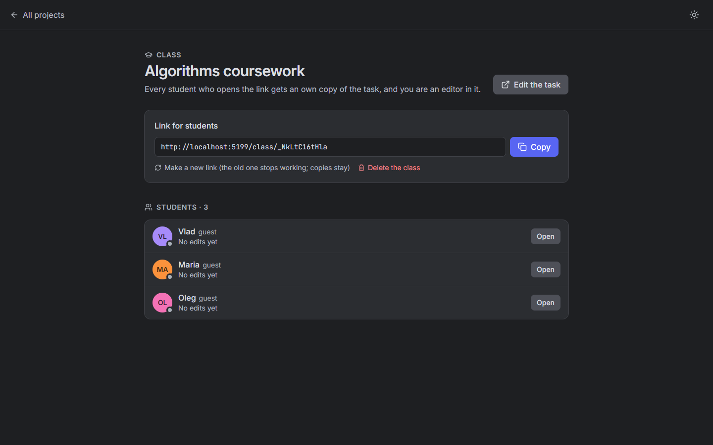
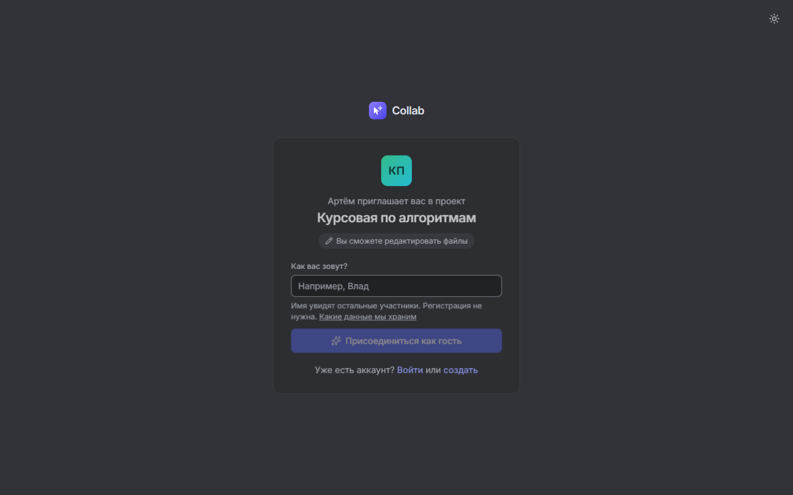
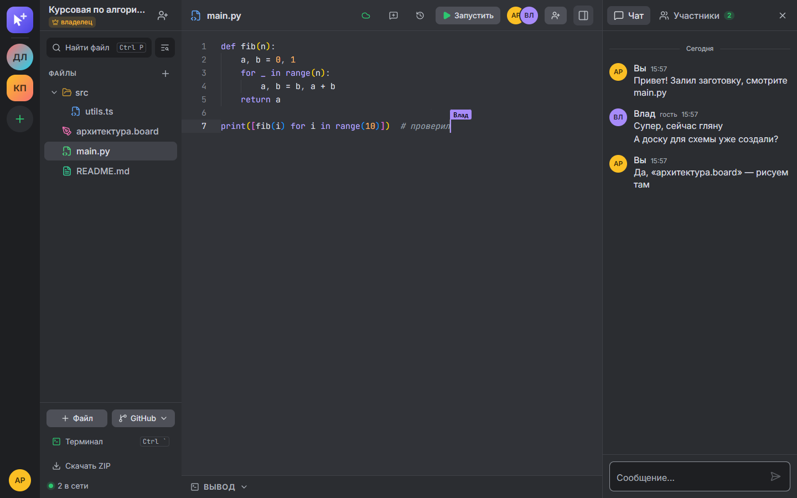
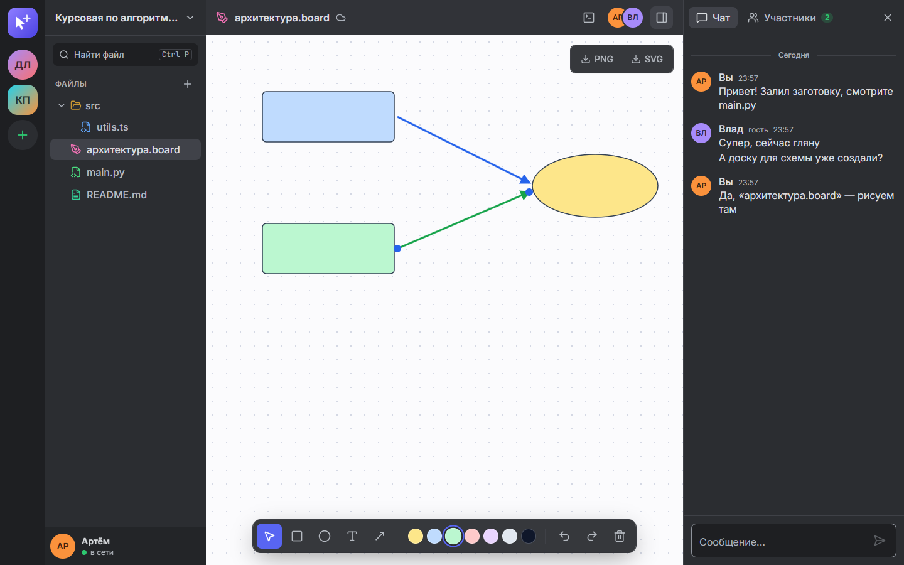

# Collab

Collab is my diploma project. It is a web app where a few people can write code in the same project at
the same time and see each other's cursors. To bring someone in, you send them a link. They don't need
an account.

Sync is built on a CRDT (the Yjs library). The other half of the diploma is a study: I compared CRDT and
OT on my own test bench by latency, correctness and server load. The short version of the results is
below.

Live version: https://35-228-155-63.sslip.io (it can be a bit behind this repository).



## Why

When a few people need to fix code together, they usually share a screen, paste pieces of code into a
messenger, or take turns pushing to one branch. It's slow, and edits get lost. I wanted something like a
Discord server, but for one project: you open a link and you have the code, documents, a board and a
chat, and you can see who is online. The project stays after the session, so you can come back to it.

## What it can do

- Join by an invite link. A guest types a name and is in the project.
- Several people edit one file at the same time, each with their own coloured cursor.
- Three kinds of files: code (the Monaco editor, the same one as in VS Code), Markdown with a live
  preview, and a board for diagrams.
- A project chat and a list of who is online.
- Classes: a teacher shares one link, every student gets their own copy of the task, and the class page
  shows who is working. The teacher can open any copy and help live.
- JavaScript, Python, C, C++ and Java run from the editor in a Docker sandbox on the server, and everyone
  sees the output. There is also a terminal.
- If the internet drops, you can keep typing. Edits are kept on the device and merge when you are back
  online.
- Import a public GitHub repository and push your changes back as a commit.
- A new project can start from an example: a short guide and a file that is ready to run.
- Accounts with email confirmation and password reset, sign-in with GitHub (when the site owner sets it
  up), or no account at all as a guest.

| Landing page | Class page |
|---|---|
|  |  |

| Invitation page | Shared editor | Board |
|---|---|---|
|  |  |  |

## Running it locally

You need Node.js 20 or newer, pnpm (`corepack enable` is the easiest way to get it) and Docker.

```bash
pnpm install
docker compose -f infra/docker-compose.dev.yml up -d   # Postgres on :5433, Redis on :6380
cp apps/api/.env.example apps/api/.env
cp apps/collab/.env.example apps/collab/.env
cp apps/web/.env.example apps/web/.env
cp packages/db/.env.example packages/db/.env
pnpm db:migrate
pnpm dev:api      # REST API on http://localhost:3001, Swagger at /docs
pnpm dev:collab   # sync server on ws://localhost:1234
pnpm dev:runner   # runs code (needs Docker)
pnpm dev:web      # web app on http://localhost:5173
```

Then open http://localhost:5173. You can sign up with an email, open an invite link from a project, or
press "Continue as guest" on the sign-in page.

A few notes:

- Postgres and Redis in Docker listen on 5433 and 6380, not on the default ports, because I already had
  local databases on those. You can change the ports in `infra/docker-compose.dev.yml` and in the `.env`
  files.
- On Windows, Docker Desktop sometimes didn't start for me after a reboot (an error about `engine.sock`
  or `dockerInference`). `pnpm docker:restart` fixes it. Don't press "Reset to factory defaults": it
  deletes all Docker data.
- To show the site to other people from your own computer, run `pnpm host:test`
  (see [docs/deploy-local.md](docs/deploy-local.md)).

## Database

Everything about the database is in [docs/db](docs/db): the data dictionary, the ER diagram, the full
DDL and how to create the database from scratch. The schema is in `packages/db/prisma/schema.prisma`,
and the migrations are next to it in `packages/db/prisma/migrations`. `pnpm db:migrate` creates the
whole structure, so nothing is done by hand. `pnpm db:schema-sql` rebuilds `docs/db/schema.sql` from the
schema.

## Tests

- `pnpm lint`, `pnpm typecheck` and `pnpm test` run over all packages. The tests need the Postgres and
  Redis from Docker.
- `pnpm --filter @collab/e2e e2e` runs the end-to-end tests: Playwright opens the app in real browsers,
  often as two people at once. With `E2E_RUNNER=1` and a running runner they also run code.

There are a bit more than 400 tests in total. GitHub Actions runs them on every push, together with lint,
typecheck and the migrations on an empty database.

## How it is built

```
├── apps/
│   ├── web/        React app (Vite, Monaco, Yjs, react-konva), PWA, invite links, guest sign-in
│   ├── api/        Fastify REST API with Swagger: auth, projects, files, chat, runs
│   ├── collab/     Hocuspocus: Yjs sync and access checks
│   └── runner/     BullMQ worker that runs code in a Docker sandbox, and the terminal
├── packages/
│   ├── shared/     Types, Zod schemas, constants
│   └── db/         Prisma schema and migrations
├── bench/          CRDT vs OT bench: scenarios, results, charts
├── e2e/            Playwright end-to-end tests
├── infra/          Dockerfiles, docker-compose, Caddyfile, deploy scripts
└── docs/           Database, UX, business analysis, ADRs, protocol, deployment, thesis chapters
```

Everything is TypeScript. The front end is React with Vite, the REST API is Fastify, and sync goes
through Hocuspocus (a server for Yjs). Data lives in PostgreSQL through Prisma, and the queue for code
runs uses Redis and BullMQ. Each file of a project is its own Yjs document. Why I chose all this is
written down in the ADRs in [docs/adr](docs/adr).

## What the study showed

The bench is in `bench/` and runs with `pnpm --filter @collab/bench bench`. I compared Yjs (CRDT) and
ShareDB (OT) with 2 to 100 users typing at the same time.

- Neither of them lost a single edit, even when everyone typed at the same position.
- Up to 50 users both have a delay of a few milliseconds. At 100 users Yjs is about twice as slow
  (p95 of 28.7 ms against 13.4 ms), which is still far below the 100 ms that people notice.
- Yjs sends 2.2–2.9 times less data per edit.
- Merging after offline work is faster with ShareDB. I expected the opposite.

So I picked CRDT not for speed but because the architecture is simpler: no server has to decide the
order of edits, and offline work needs no extra logic. The full tables are in
[bench/results/REPORT.md](bench/results/REPORT.md), and the discussion is in
[docs/thesis/04-research.md](docs/thesis/04-research.md).

## Running it as a service

- **Email.** Set `SMTP_URL` and `MAIL_FROM` for confirmation and password reset emails. Without them, a
  development server prints the links to its log.
- **GitHub sign-in.** Create an OAuth app on GitHub and set `GITHUB_CLIENT_ID` and `GITHUB_CLIENT_SECRET`.
- **Safer sandbox.** `infra/gcp/enable-gvisor.sh` installs gVisor on the server, and code then runs with
  its own user-space kernel (`SANDBOX_RUNTIME=runsc`).
- **Limits.** Projects per person, files per project and runs per minute (`MAX_PROJECTS_PER_USER`,
  `MAX_FILES_PER_PROJECT`, `RUNS_PER_MINUTE`).
- **Backups.** The `backup` service dumps the database every day and keeps 7 days.
- **Health.** `/health/ready` answers 200 only when the database and Redis work; point an uptime monitor
  at it. Errors from browsers go to the server log.
- **Usage numbers.** `pnpm --filter @collab/api stats` prints active and returning people, sessions with
  two or more people, runs and class joins for the last 7 days. The numbers stay on the server.

More in [docs/deploy-gcp.md](docs/deploy-gcp.md) and [docs/roadmap.md](docs/roadmap.md).

## Known limitations

- Without gVisor, code runs in a container that shares the kernel with the server. Turn gVisor on before
  running strangers' code in public.
- Import works only for public GitHub repositories. Pushing a commit was tested against a fake GitHub in
  the tests, not against a real repository.
- The API runs as one instance. To scale out, its events would have to go through Redis pub/sub.
- I wrote the AWS guide but never ran it on a real account. Only the Google Cloud deployment is tested.
- You can't add pictures to the board yet.

## Documentation

- [docs/roadmap.md](docs/roadmap.md): what is done to make this a product, and what is next
- [docs/db](docs/db): database (data dictionary, ER diagram, migrations, DDL)
- [docs/ux](docs/ux): UX specification with scenarios, errors, visual style, components and screens (PDF)
- [docs/ba](docs/ba): business analysis
- [docs/adr](docs/adr): architecture decisions
- [docs/websocket-protocol.md](docs/websocket-protocol.md): real-time protocols
- [docs/deploy-local.md](docs/deploy-local.md), [docs/deploy-gcp.md](docs/deploy-gcp.md),
  [docs/deploy-aws.md](docs/deploy-aws.md): deployment
- [docs/thesis](docs/thesis): thesis chapters
- Swagger: `http://localhost:3001/docs` while the API is running

## Author

Artsiom Harminovich, diploma project. Supervisor: Maksym Svynarenko.
