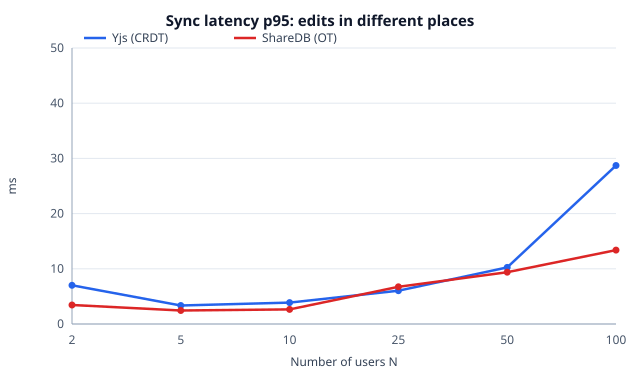
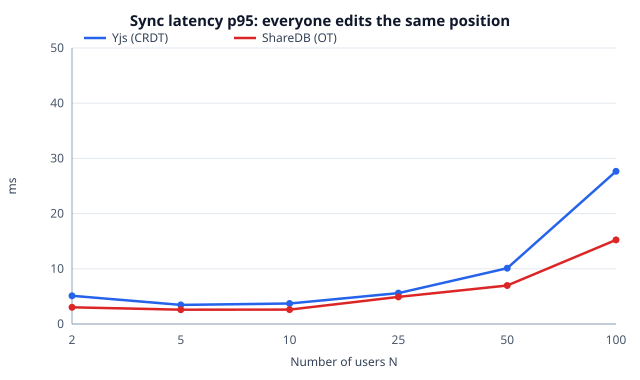
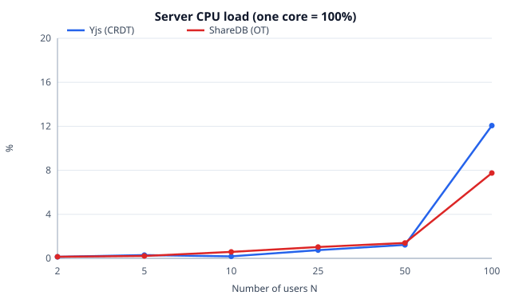
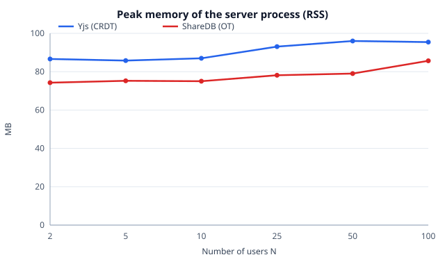
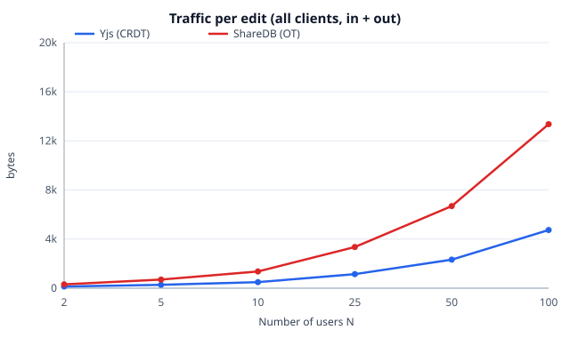
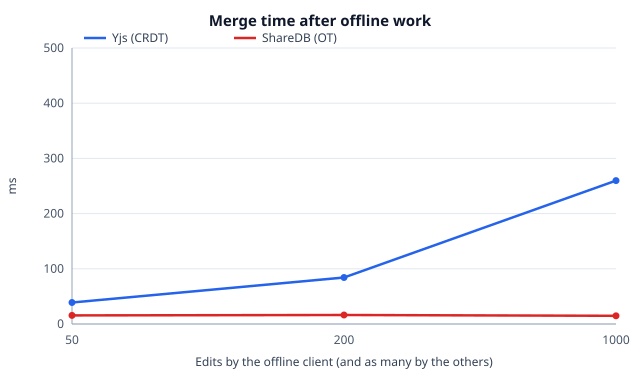
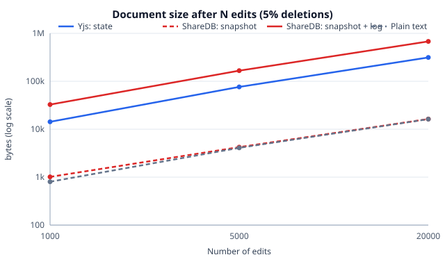
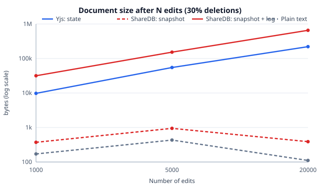
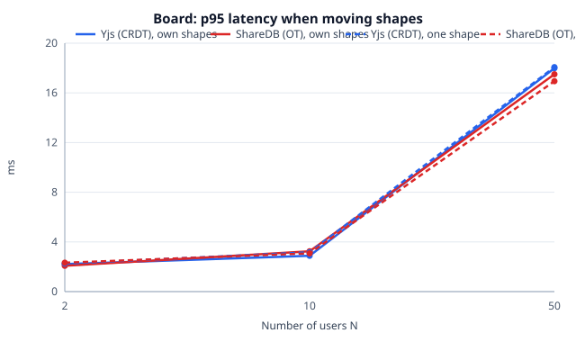

# Bench results: CRDT (Yjs) vs OT (ShareDB)

Run: 2026-10-02T10:40:23.395Z. Node v22.18.0, Windows_NT 10.0.22631 x64, AMD Ryzen 7 5700U with Radeon Graphics (16 threads), 14 GB RAM. Repeats per point: 3; typing time: 10 s; typing speed: 1 edits/s per user.

The server of each system runs as a separate process (to measure its CPU and memory fairly), and the client bots run in separate processes (up to 8, with 12 clients each), so the load generator does not become the bottleneck. Latency is measured from the insert call at the author to the edit appearing at another client (the machine's shared clock). The servers are compared without a database: Hocuspocus in memory and ShareDB with in-memory storage, so the sync algorithm itself is compared, not the storage layer.

## 1. Typing at the same time: latency, correctness, load

### Edits in different places of the file

| N | System | mean ms | p50 | p95 | p95, repeat range | p99 | Server CPU, % | RSS, MB | bytes/edit | Converged, nothing lost | Rig not overloaded |
| --- | --- | --- | --- | --- | --- | --- | --- | --- | --- | --- | --- |
| 2 | Yjs (CRDT) | 2.5 | 2.0 | 7.0 | 4.0–9.3 | 8.7 | 0 | 87 | 141 | yes | yes |
| 2 | ShareDB (OT) | 1.8 | 1.6 | 3.4 | 2.4–4.2 | 4.0 | 0 | 74 | 311 | yes | yes |
| 5 | Yjs (CRDT) | 2.3 | 2.1 | 3.4 | 3.1–3.5 | 7.7 | 0 | 86 | 275 | yes | yes |
| 5 | ShareDB (OT) | 1.7 | 1.6 | 2.4 | 2.3–2.6 | 4.3 | 0 | 75 | 705 | yes | yes |
| 10 | Yjs (CRDT) | 2.5 | 2.4 | 3.9 | 3.8–3.9 | 5.7 | 0 | 87 | 490 | yes | yes |
| 10 | ShareDB (OT) | 1.8 | 1.8 | 2.6 | 2.6–2.7 | 4.2 | 1 | 75 | 1363 | yes | yes |
| 25 | Yjs (CRDT) | 3.0 | 2.8 | 6.0 | 4.7–7.3 | 8.0 | 1 | 93 | 1147 | yes | yes |
| 25 | ShareDB (OT) | 2.7 | 2.0 | 6.7 | 4.5–8.3 | 8.2 | 1 | 78 | 3355 | yes | yes |
| 50 | Yjs (CRDT) | 4.5 | 4.0 | 10.3 | 9.1–11.1 | 15.4 | 1 | 96 | 2323 | yes | yes |
| 50 | ShareDB (OT) | 3.7 | 2.8 | 9.4 | 7.0–12.3 | 11.9 | 1 | 79 | 6686 | yes | yes |
| 100 | Yjs (CRDT) | 11.8 | 9.9 | 28.7 | 25.7–33.9 | 41.5 | 12 | 95 | 4743 | yes | yes |
| 100 | ShareDB (OT) | 5.8 | 5.0 | 13.4 | 12.6–14.1 | 18.9 | 8 | 86 | 13360 | yes | yes |

### Everyone inserts at the same position (most conflicts)

| N | System | mean ms | p50 | p95 | p95, repeat range | p99 | Server CPU, % | RSS, MB | bytes/edit | Converged, nothing lost | Rig not overloaded |
| --- | --- | --- | --- | --- | --- | --- | --- | --- | --- | --- | --- |
| 2 | Yjs (CRDT) | 2.4 | 2.0 | 5.1 | 3.3–8.5 | 8.4 | 0 | 87 | 127 | yes | yes |
| 2 | ShareDB (OT) | 1.8 | 1.6 | 3.0 | 2.4–4.2 | 4.5 | 0 | 73 | 310 | yes | yes |
| 5 | Yjs (CRDT) | 2.2 | 2.0 | 3.5 | 3.0–3.9 | 8.0 | 0 | 87 | 241 | yes | yes |
| 5 | ShareDB (OT) | 1.7 | 1.5 | 2.6 | 2.5–2.8 | 3.8 | 1 | 74 | 704 | yes | yes |
| 10 | Yjs (CRDT) | 2.5 | 2.4 | 3.7 | 3.4–4.0 | 6.6 | 1 | 89 | 432 | yes | yes |
| 10 | ShareDB (OT) | 1.8 | 1.7 | 2.6 | 2.6–2.7 | 3.6 | 0 | 75 | 1347 | yes | yes |
| 25 | Yjs (CRDT) | 3.0 | 2.9 | 5.6 | 4.5–6.4 | 7.5 | 1 | 93 | 1039 | yes | yes |
| 25 | ShareDB (OT) | 2.4 | 2.2 | 4.9 | 4.1–6.1 | 6.3 | 1 | 77 | 3307 | yes | yes |
| 50 | Yjs (CRDT) | 4.4 | 3.8 | 10.1 | 8.7–11.7 | 14.1 | 1 | 95 | 2019 | yes | yes |
| 50 | ShareDB (OT) | 3.2 | 2.9 | 7.0 | 6.9–7.1 | 9.5 | 1 | 78 | 6565 | yes | yes |
| 100 | Yjs (CRDT) | 11.5 | 9.6 | 27.7 | 25.0–29.5 | 39.8 | 12 | 97 | 3996 | yes | yes |
| 100 | ShareDB (OT) | 6.2 | 5.1 | 15.2 | 13.5–16.9 | 23.4 | 8 | 87 | 13110 | yes | yes |

Measurement check: the "Rig not overloaded" column means the event loop lag (p99) in the bot processes is under 100 ms. If it is higher, the measured latency shows an overloaded load generator, not the server, and such a point cannot be read as a property of the algorithm. The background value on this machine is about 20–25 ms (Windows timer granularity).

## 2. Offline work

One client disconnects and makes K edits locally, while the others make another K edits; then the client comes back. The time is counted from the reconnect until everyone has the same text.

| K | System | Merge, ms | Repeat range, ms | Traffic during merge, KB | Converged, nothing lost |
| --- | --- | --- | --- | --- | --- |
| 50 | Yjs (CRDT) | 39 | 36–41 | 16.0 | yes |
| 50 | ShareDB (OT) | 16 | 15–16 | 5.6 | yes |
| 200 | Yjs (CRDT) | 84 | 80–90 | 67.3 | yes |
| 200 | ShareDB (OT) | 16 | 16–17 | 16.8 | yes |
| 1000 | Yjs (CRDT) | 260 | 239–301 | 346.1 | yes |
| 1000 | ShareDB (OT) | 15 | 14–17 | 75.6 | yes |

## 3. Document size

Five clients make the given number of edits (inserting one character or deleting 1–5 characters at a random place). "To open" is how many bytes a client joining the document has to receive (for Yjs the whole state, for ShareDB the snapshot). "Stored in total" adds the operation log for ShareDB, from which any version can be rebuilt; Yjs has no version history but keeps tombstones for deleted content.

### 5% deletions

| Edits | System | To open, bytes | Stored in total, bytes | Total per edit, bytes | Plain text, bytes |
| --- | --- | --- | --- | --- | --- |
| 1000 | Yjs (CRDT) | 14286 | 14286 | 14.3 | 803 |
| 1000 | ShareDB (OT) | 1015 | 32713 | 32.7 | 807 |
| 5000 | Yjs (CRDT) | 76228 | 76228 | 15.2 | 4089 |
| 5000 | ShareDB (OT) | 4223 | 166445 | 33.3 | 4014 |
| 20000 | Yjs (CRDT) | 314089 | 314089 | 15.7 | 16236 |
| 20000 | ShareDB (OT) | 16331 | 678273 | 33.9 | 16122 |

### 30% deletions

| Edits | System | To open, bytes | Stored in total, bytes | Total per edit, bytes | Plain text, bytes |
| --- | --- | --- | --- | --- | --- |
| 1000 | Yjs (CRDT) | 9766 | 9766 | 9.8 | 171 |
| 1000 | ShareDB (OT) | 372 | 31596 | 31.6 | 164 |
| 5000 | Yjs (CRDT) | 54824 | 54824 | 11.0 | 433 |
| 5000 | ShareDB (OT) | 944 | 152581 | 30.5 | 735 |
| 20000 | Yjs (CRDT) | 220399 | 220399 | 11.0 | 111 |
| 20000 | ShareDB (OT) | 389 | 657776 | 32.9 | 180 |

## 4. Design board: moving shapes

| Mode | N | System | p50, ms | p95, ms | States match |
| --- | --- | --- | --- | --- | --- |
| each moves their own | 2 | Yjs (CRDT) | 1.5 | 2.2 | yes |
| each moves their own | 2 | ShareDB (OT) | 1.4 | 2.1 | yes |
| each moves their own | 10 | Yjs (CRDT) | 1.8 | 2.9 | yes |
| each moves their own | 10 | ShareDB (OT) | 1.8 | 3.2 | yes |
| each moves their own | 50 | Yjs (CRDT) | 6.6 | 18.0 | yes |
| each moves their own | 50 | ShareDB (OT) | 6.3 | 17.5 | yes |
| everyone moves one | 2 | Yjs (CRDT) | 1.5 | 2.3 | yes |
| everyone moves one | 2 | ShareDB (OT) | 1.5 | 2.3 | yes |
| everyone moves one | 10 | Yjs (CRDT) | 1.8 | 3.2 | yes |
| everyone moves one | 10 | ShareDB (OT) | 1.8 | 3.1 | yes |
| everyone moves one | 50 | Yjs (CRDT) | 6.8 | 18.1 | yes |
| everyone moves one | 50 | ShareDB (OT) | 6.1 | 16.9 | yes |

