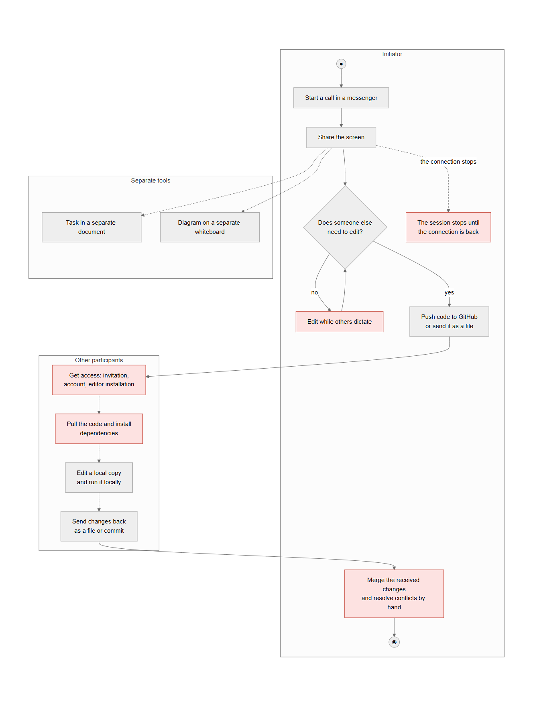
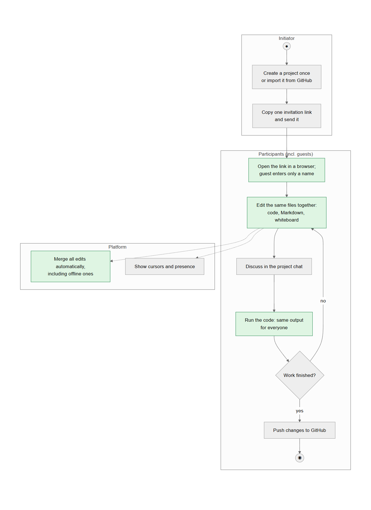
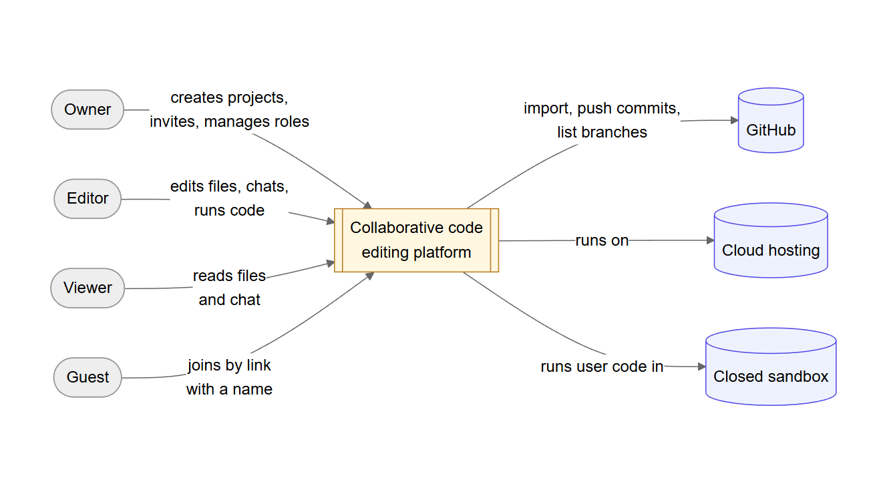
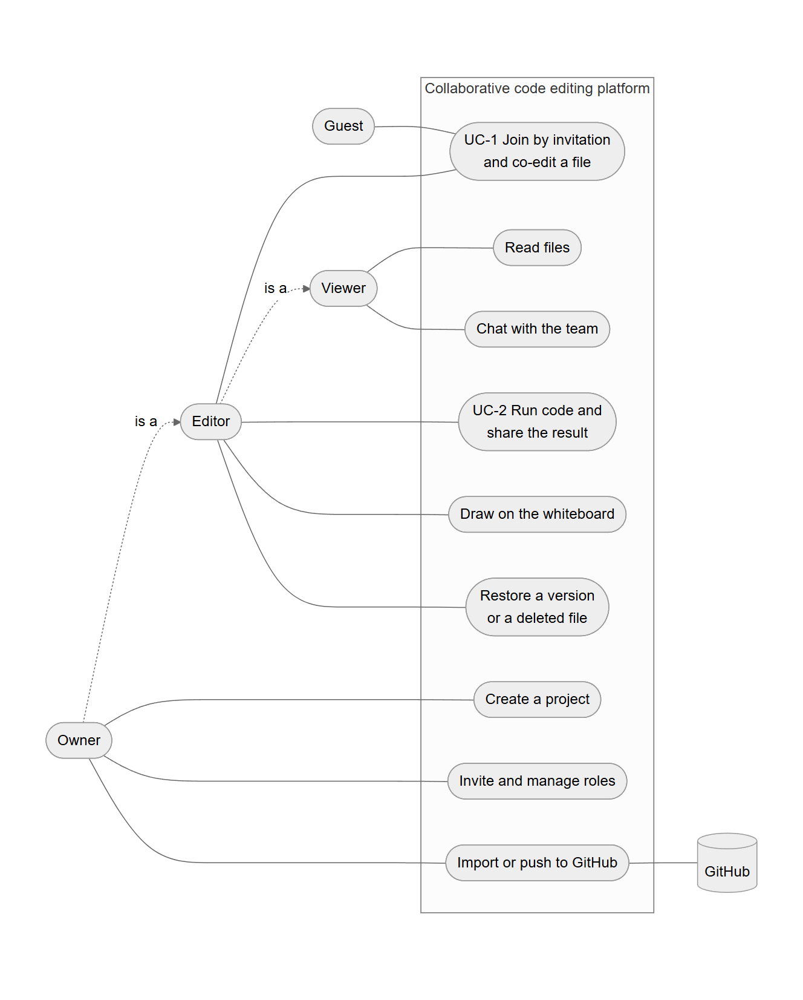
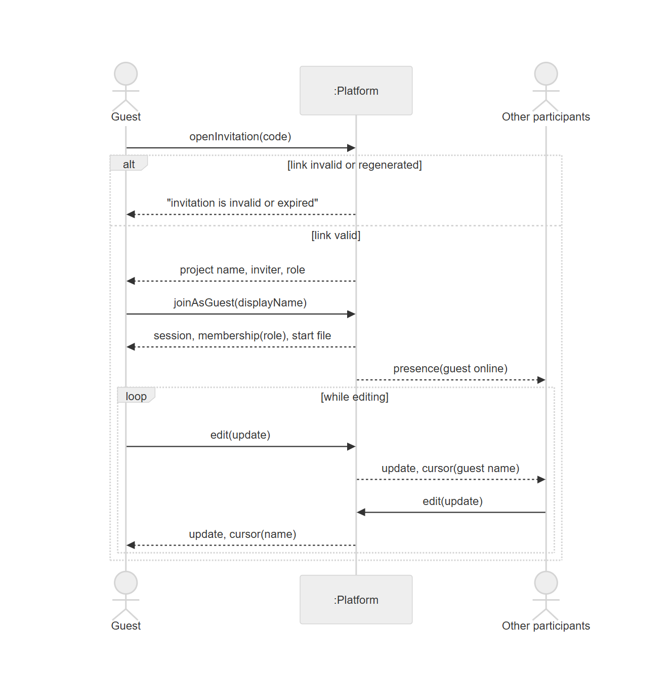
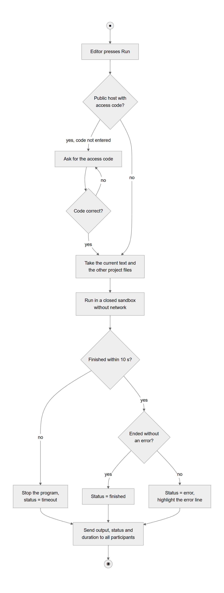
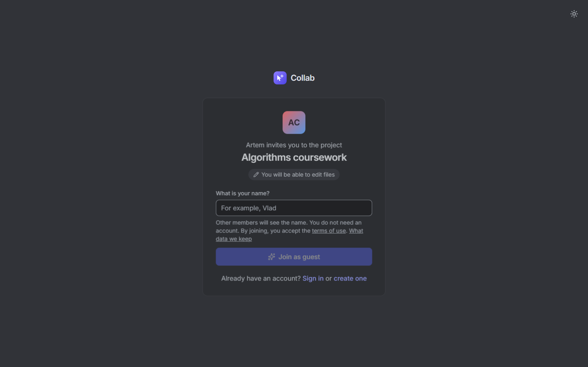
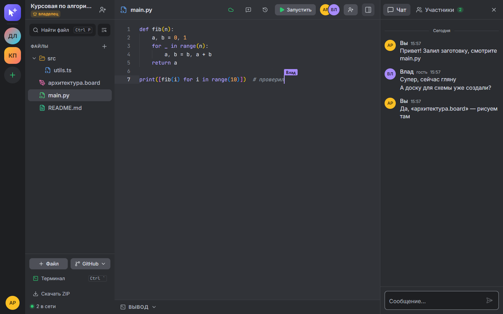
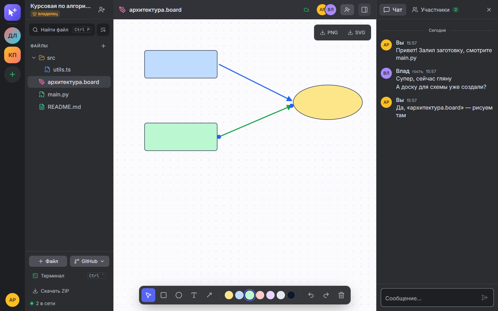
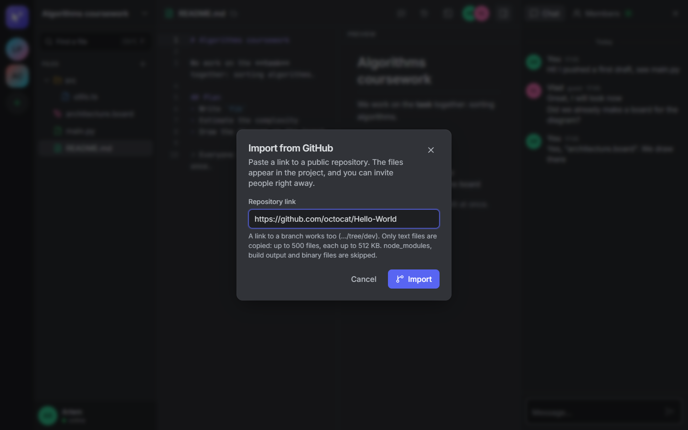

# List of references

The sources follow the Chicago notes-bibliography style: a note at the bottom of the page for each citation, and this list in alphabetical order.

{{bibliography}}

# Appendix 1. Backlog

Table A1.1 — Epics and user stories (MoSCoW: M is Must, S is Should, C is Could, W is Won't)

| ID | Epic | User story | Acceptance criteria | MoSCoW |
|---|---|---|---|---|
| US-01 | E1 | As a student, I want to create a project, so that my team has a permanent shared space. | Given a signed-in user, when the user creates a project with a name, then the project appears in the user's list, the user is the owner, and the project opens empty. | M |
| US-02 | E1 | As a project owner, I want to invite people with a link, so that they can join without any setup. | Given a project, when the owner opens "Invite", then the system shows a link with a role to choose (editor or viewer), and the owner can copy it; when the owner makes a new link, then the old link stops working. | M |
| US-03 | E1 | As a guest, I want to join a project by a link and enter only my name, so that I can start without registration. | Given a valid editor link and a visitor who is not signed in, when the visitor enters a name and confirms, then the visitor becomes an editor and the project opens within 5 s; given an invalid link, then the system shows an explanation and creates no membership. | M |
| US-04 | E1 | As an owner, I want to change roles and remove members, so that I control who can change files. | Given a member with open files, when the owner changes the role to viewer, then the editor of the member becomes read-only without a reload; when the owner removes the member, then the tabs of the member leave the project with a notice. | M |
| US-05 | E1 | As a user, I want to register and sign in with e-mail and password, so that the system keeps my projects between sessions. | Given a new e-mail and a password of at least 8 characters, when the user registers, then the user is signed in; given a wrong password, when the user signs in, then the system shows "Invalid e-mail or password" and does not say which one is wrong. | M |
| US-06 | E1 | As a member, I want to leave a project, and as an owner I want to delete it, so that my list stays useful. | Given a member, when the member leaves, then the project disappears from the list of the member; given the owner, when the owner confirms deletion, then the project is deleted for all members. | S |
| US-27 | E1 | As a user, I want to delete my account and my personal data, so that I can use my right to erasure. | Given a signed-in user, when the user confirms account deletion, then the system deletes the account, its memberships, its chat messages and owned projects. | S |
| US-07 | E2 | As an editor, I want to edit the same file at the same time as others and see their changes at once, so that we work like at one screen. | Given two editors in one file, when one types, then the text appears for the other within 100 ms (p95), and both copies are identical after the edits stop. | M |
| US-08 | E2 | As a participant, I want to see the cursors and names of others and who is online, so that we do not edit the same place by accident. | Given two participants, when one moves the cursor, then the other sees a cursor with the name, and both are in the list of people online. | M |
| US-09 | E2 | As a participant with a bad connection, I want to keep editing offline and have my edits merged automatically, so that I lose no work. | Given an editor who loses the connection, when the editor keeps typing and reconnects, then the system merges all offline and parallel edits without a conflict dialog and without lost characters. | M |
| US-10 | E2 | As a user, I want syntax highlighting for common languages, so that code is easy to read. | Given a file with a known extension (.js, .ts, .py, …), when it opens, then the system applies the matching highlighting; the user can open the list of supported languages; for an unknown extension, the system says that the file opens as plain text. | S |
| US-11 | E3 | As a student, I want Markdown documents with a live preview, so that task descriptions are next to the code. | Given a Markdown file, when a participant types, then the preview updates for all participants. | S |
| US-12 | E3 | As a team member, I want a shared whiteboard with shapes, text and arrows, so that we can draw the design next to the code. | Given a whiteboard, when a participant draws a shape or adds a text label, then all participants see it, and it can be undone and exported to PNG or SVG. | S |
| US-13 | E4 | As a member, I want a project chat, so that the discussion stays with the code. | Given two members, when one sends a message, then the other gets it in real time and it stays in the history. | S |
| US-14 | E5 | As an editor, I want to run a JavaScript or Python file in a sandbox and see the output together with others, so that we check the same result. | Given a file that can run, when an editor presses Run, then all participants see the output, status and duration; if there is an error, the system highlights the line; the system stops a run after 10 s, and an editor can stop it earlier with a button. | S |
| US-15 | E5 | As an editor, I want an interactive terminal in a sandbox with the project files, so that I can run commands like in Git Bash. | Given an editor, when the terminal opens, then a shell with the project files is available, it has no network, a button stops a program as Ctrl+C does, and it closes after 30 min or when the panel closes. | C |
| US-16 | E5 | As the operator of a public instance, I want code execution to need an access code, so that other people cannot use my server. | Given a public instance with an access code, when a user without the code presses Run, then the system asks for the code and the run starts only after a correct code. | C |
| US-17 | E6 | As a student, I want to import a public GitHub repository by its URL, so that I can start from existing code. | Given a public repository URL, when the user creates a project from it, then the text files appear in the project with their folder structure. | S |
| US-18 | E6 | As a student, I want to push my changes back to GitHub as a commit, so that the repository keeps my work. | Given a project linked to a repository and a valid token, when the user pushes, then the system commits the changed files and reports a conflict with newer remote changes instead of replacing them. | C |
| US-19 | E6 | As a student, I want to change between repository branches, so that I can work on the branch I need. | Given an imported repository, when an editor selects another branch, then all participants see the files of that branch. | C |
| US-20 | E7 | As an editor, I want a folder tree where I can create, rename and delete files, so that the project stays organised. | Given an editor, when the editor creates "src/app.js", then the folder "src" appears in the tree for all participants; all participants also see renamed and deleted files. | M |
| US-21 | E7 | As an editor, I want deleted files to stay in a trash for 30 days, so that I can undo mistakes. | Given a deleted file, when an editor opens the trash, then the system shows the file with the remaining days and the editor can restore it; after 30 days the system removes it. | S |
| US-22 | E7 | As an editor, I want to see the version history of a code file or a document and restore a version, so that I can undo a bad change. | Given a code file or a document with saved versions, when an editor restores one, then all participants see the restored text and the system saves the replaced text as a new version. | S |
| US-23 | E7 | As a user, I want to search by file name and by file content, so that I can find things in a large project. | Given a project, when the user searches for a text, then the system lists matching files and lines, and a click opens the file at that line. | S |
| US-24 | — | As a team, we want voice and video calls in the project. | Out of scope (section 2.3). | W |
| US-25 | — | As a developer, I want a step-by-step debugger. | Out of scope (section 2.3). | W |
| US-26 | — | As a student, I want to import a private GitHub repository. | Out of scope for this release (section 2.3). | W |

# Appendix 2. Diagrams

**UC-2 Run code and share the result**

- *Actor:* Editor (also: other participants).
- *Precondition:* the editor has a JavaScript or Python file open. Code execution is turned on at the server.
- *Postcondition:* all participants see the output, the status and the duration of the run.
- *Main flow:*
  1. The editor presses "Run".
  2. The system takes the current text of the file and the other text files of the project.
  3. The system runs the program in a closed sandbox without network access.
  4. The system sends the output to all participants who have the file open.
  5. The system shows the status ("finished" or "error") and the duration. If there is an error, it highlights the line with the error.
- *Alternative flows:*
  - A1 (step 3): the program runs longer than 10 s. The system stops it and shows the status "timeout".
  - A2 (step 1): the server is a public host with an access code. The system asks for the code once and continues after a correct code.

# Appendix 3. Survey questionnaire

The questionnaire is ready for online use in Russian. Nobody has answered it yet. The English translation is below. Questions 2 and 8 check the problem hypothesis. Questions 4–7 give first values for KPI-1, KPI-2, KPI-3 and problem P6. Section 2.10 has the rule for the answers.

0. Consent: "I agree that my anonymous answers can be used in summary form in the diploma thesis." (required)
1. Who are you? (IT student / student of another field / working developer / lecturer / other)
2. How often do you work on code or a study project with other people? (never this semester / monthly / weekly / several times a week / daily)
3. Which tools do you use for this work? (you can choose many: Discord, Telegram, Zoom/Meet/Teams screen sharing, GitHub/GitLab, Google Docs, VS Code Live Share, Replit, CodeSandbox, Miro/FigJam or another whiteboard, sending files in a messenger, other)
4. How many different apps or sites are usually open during one session? (1 / 2 / 3 / 4 / 5 or more)
5. How long does it usually take to start working with another person on the same code? (< 1 min / 1–5 / 5–15 / 15–30 / > 30 min)
6. In the last month, how many times did you lose edits of another person or fix a merge conflict? (0 / 1–2 / 3–5 / > 5 / don't remember)
7. In the last month, how many times did the connection of someone stop during a session? (0 / 1–2 / 3–5 / > 5 / don't remember)
8. What are your biggest problems? (up to three: registration or installation for participants; conflicts and lost edits; code runs differently on different computers; code, documents and diagrams are in different places; you cannot see who edits what; the connection stops or is slow; a paid plan is needed; other)
9. Have you used VS Code Live Share, Replit or CodeSandbox? What did you not like? (open answer)
10. How important are these things (1–5): join by a link without registration; live cursors and edits; running code together in the browser; chat next to the code; a whiteboard in the same project; offline work with later synchronisation; version history; pushing to GitHub.
11. What would you add to such a tool? (open answer)

# Appendix 4. Keystroke-level estimate of KPI-1

The Keystroke-Level Model [@card] adds the times of small actions: M is thinking before an action (1.35 s). P is pointing with the mouse (1.1 s). K is a key press or a click (0.2 s, an average skilled typist). H is moving a hand between the keyboard and the mouse (0.4 s). R is waiting for the system. The R values are assumptions for a small project on a good connection. The model is for experts who make no mistakes, so all figures are lower limits. The installation of Git, an editor and a runtime is not included, because it depends on the computer. The reference task: a small project is already in a Git repository, and two people start to edit the same file.

Table A4.1 — AS-IS, both people have all accounts and tools

| Step | M | P | K | H | R, s | Time, s |
|---|---|---|---|---|---|---|
| Owner: open repository settings, then Collaborators | 1 | 2 | 2 | 1 | 2 | 6.35 |
| Owner: add the partner by user name | 1 | 2 | 12 | 2 | 1 | 7.75 |
| Owner: send the repository link in a messenger | 2 | 1 | 8 | 2 | 0 | 6.20 |
| Partner: open the invitation and accept it | 1 | 2 | 2 | 0 | 4 | 7.95 |
| Partner: clone the repository | 1 | 0 | 15 | 1 | 3 | 7.75 |
| Partner: enter the folder and open the editor | 2 | 0 | 23 | 0 | 3 | 10.30 |
| Partner: install the dependencies | 1 | 0 | 12 | 0 | 10 | 13.75 |
| Partner: open the file | 1 | 1 | 1 | 1 | 1 | 4.05 |
| **Total** | 10 | 8 | 75 | 7 | 24 | **64.10** |

Table A4.2 — AS-IS, extra steps when the partner has no account at the Git host

| Step | M | P | K | H | R, s | Time, s |
|---|---|---|---|---|---|---|
| Partner: fill in the registration form | 3 | 4 | 46 | 2 | 2 | 20.45 |
| Partner: confirm the e-mail address with a code | 2 | 2 | 12 | 2 | 12 | 20.10 |
| **Total** | 5 | 6 | 58 | 4 | 14 | **40.55** |

Table A4.3 — TO-BE on the platform, the partner joins as a guest

| Step | M | P | K | H | R, s | Time, s |
|---|---|---|---|---|---|---|
| Owner: create a project from the repository link | 2 | 2 | 16 | 2 | 3 | 11.90 |
| Owner: open Invite and copy the link | 1 | 2 | 2 | 0 | 1 | 4.95 |
| Owner: send the link in a messenger | 1 | 0 | 5 | 1 | 0 | 2.75 |
| Guest: open the link | 1 | 1 | 1 | 1 | 2 | 5.05 |
| Guest: enter a name and confirm | 1 | 0 | 9 | 1 | 2 | 5.55 |
| **Total** | 6 | 5 | 33 | 5 | 8 | **30.20** |

**Result.** The task takes about 64 s (83 key presses and pointing actions) when everybody is ready. It takes about 105 s (147) when the partner must register first. On the platform it takes about 30 s (38). These are estimates for experts, not measurements. The times have two decimals, so the rows add up to the totals. KPI-1 uses the case with no account: 105 s against 30 s. The pilot of section 2.10 will measure first-time users on both sides.

# Appendix 5. Terms

Table A5.1 — Terms used in this document

| Term | Meaning |
|---|---|
| Acceptance criteria | Conditions that show that a user story is done |
| Analog | An existing product that solves a similar problem |
| AS-IS, TO-BE | The process today; the process with the new system |
| Baseline | The value of a KPI before the new system (the start value) |
| Commit, push, merge | Git actions: save a set of changes; send them to a server; join two versions of the code |
| CRDT | Conflict-free Replicated Data Type: data whose copies always become the same without a central server |
| Enabler | A story that serves no goal alone, but other stories need it |
| Epic | A large group of user stories |
| Hypothesis | A statement that is not proved yet and must be checked |
| Initiator | The person who starts a session |
| KPI | Key Performance Indicator: a number that shows if a goal is reached |
| Merge conflict | Two people changed the same place, so a person must choose the result |
| Mitigation | An action that makes a risk smaller |
| Mockup | A picture of a screen |
| MoSCoW | Four priorities of a story: Must, Should, Could, Won't |
| NFR | Non-functional requirement: how well the system must work, for example its speed or security |
| OT | Operational Transformation: a method where a server changes operations so that all copies become the same |
| p95 (95th percentile) | 95% of the measured values are at or below this value |
| Persona | An example user, made to describe a group of real users |
| Pilot | A small test with real users |
| Repository | The place where Git keeps the code of a project |
| Sandbox | A closed place for running code, separate from the rest of the server |
| Stakeholder | A person or group with an interest in the project |
| Traceability | Links that show which goal each user story comes from |
| User story | A short description of a need: "As a …, I want …, so that …" |

# Statements

**Use of AI.** The author used the AI assistant Claude (Anthropic) through the Claude Code tool for these tasks: writing the English text of the Introduction, Chapters 1–2 and the appendices from the author's project and the department's requirements; rewriting this text in simple English; changing the text after the interim and final reviews of the expert (goal, KPIs, problems, traceability, alternatives, analogs, non-functional and legal requirements, reference style); finding and checking sources, bibliographic data and figures, including the documentation of CodeSandbox, StackBlitz, GitHub Codespaces and JetBrains Code With Me; using a browser for the practical tests of CodeShare.io, Yjs and Excalidraw and taking their screenshots; making the diagrams of Appendix 2; calculating the keystroke-level estimate of Appendix 4; and helping to build and test the software prototype. The author checked the document and is responsible for its content. The project is individual. It is not done for an organisation or with the data of an organisation.

**Group contributions.** Not applicable: the project is individual.

**Organisation consent.** Not applicable: the project is not done for an organisation and does not use the data of an organisation.
