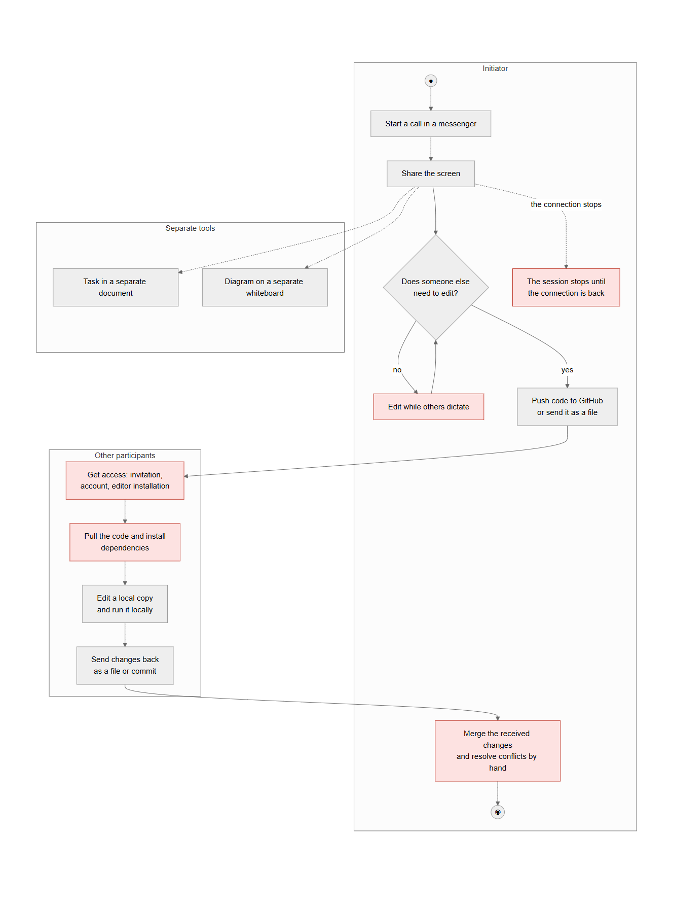
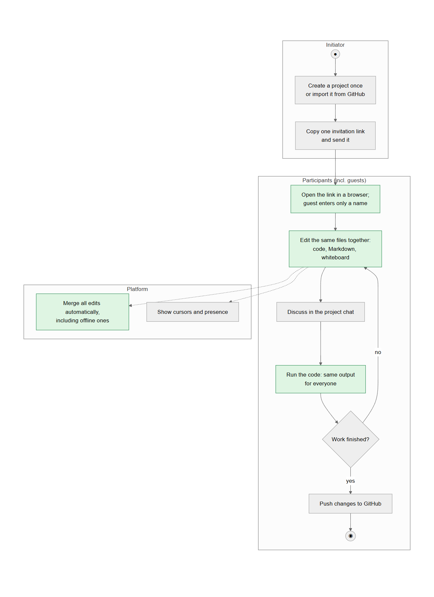
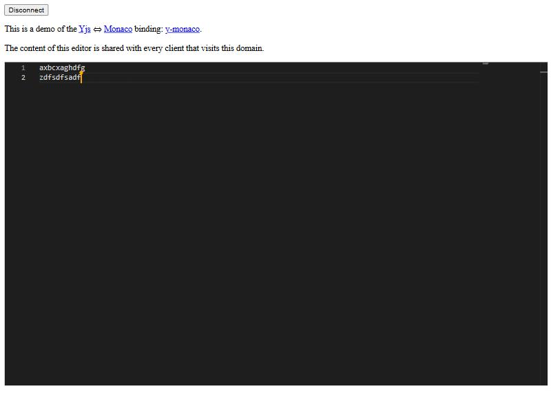

# Introduction

**Relevance and problem.** Many people write software together, but they are not in one room. In the Stack Overflow Developer Survey 2024, 54,806 people answered a question about their work. Of them, 80% work remotely (38%) or in a hybrid mode (42%) [@stackoverflow]. This number shows that remote work is normal. It does not show that editing code together is a problem.

So the problem of this work is a hypothesis:

*Students, the mentors who help them and small teams lose time and work when they start to edit the same code in a live session, because they need many separate tools.*

A normal session looks like this. People talk in a messenger or a call. They show code with screen sharing and send it through GitHub. The task is in one document, and the diagram is on a whiteboard. Each tool needs its own invitation, and often an account or an installation.

Three sources support this hypothesis, but they do not prove it:

- In a study of remote pair programming, 94 students worked in pairs for one semester. The authors say that two technical problems are hard to solve: setting up the software of students and keeping a stable internet connection [@xinogalos].
- In a poll of 1,416 students in England in 2020, 52% said that a slow or unreliable connection affected their learning [@ofs]. This was during the lockdown, and the poll was not about code.
- A study of nine open-source projects found a text conflict in 17% of Git merges [@brun]. The study is from 2011, and it is about Git, not about live sessions. It only shows that work on separate copies has a cost.

**What is not known yet.** We do not know how many students and teams have such sessions, or how often. We do not know how long the start really takes for new users. We do not know how often people lose work or lose the connection. Nobody from the target groups has been asked yet. So the questionnaire (Appendix 3) and the pilot (section 2.10) must confirm or reject the hypothesis.

**Why it matters now.** Remote and hybrid work is normal now [@stackoverflow]. Real-time tools exist, but they have limits. They need one desktop editor or a paid plan, or they show one file without the project (section 1.3).

**Goal and objectives.** The goal of this work is to reduce the time to the first shared edit in live sessions of students and mentors to one minute or less and to remove lost edits.

The work has five objectives:

1. Describe how people work on code together today and where they lose time and work.
2. Study sources and compare existing products, to find what is missing.
3. Define the vision, the KPIs, the stakeholders and the scope of a solution.
4. Write the requirements and choose a solution concept from alternatives.
5. Plan how to check the result: a pilot with new users, a questionnaire and criteria linked to the KPIs.

The software and the experiment with OT and CRDT are not objectives of this block. They are in the explanatory note of the thesis.

**Object and subject.** The *object* is a process: a small team works together on a software project in real time. The *subject* is the part of this process that software can do. Software can let people edit the same files at the same time. It can show who is online, let people talk and control access. It can also run code in a safe place and exchange the project with a Git repository.

**Methods.** The requirements come from three methods:

- *Document analysis:* scientific papers, product documentation, laws and standards (section 1.2).
- *Comparison of analogs:* nine products were compared on the same criteria. The products that work without registration were tested in two browser windows (section 1.3).
- *Process modelling and task analysis:* a UML activity diagram shows the current process (Figure 1.1). The Keystroke-Level Model (KLM) [@card] adds the times of small actions. It gives a time estimate when there is no data from users (Appendix 4).

A working prototype also exists. It shows that the requirements are possible. But it creates a risk: requirements can start to describe what is already built (R8 in section 2.9). To reduce this risk, each user story is linked to a goal or marked as an enabler or a legal need, and the requirements do not name technologies. The prototype is described in the explanatory note.

A questionnaire is ready (Appendix 3). Nobody has answered it yet, and there were no interviews. So this document has no survey or interview data.

# Chapter 1. Analytical part

## 1.1 Current state of the process

**How the task is solved today.** Sometimes two or more people must work on the same code at the same time. For example: a lab task, a bug that a student cannot fix alone, a talk with a lecturer, or a code review. Usually they build the session from several general tools. The tools and their documentation show this typical AS-IS process (Figure 1.1, full size in Appendix 2):

1. The initiator starts a call in a messenger (Discord, Telegram, Zoom, Teams) and shares the screen.
2. The others watch and say what to change. Only the person who shares the screen can edit.
3. When another person must edit, the code goes out as a file or to GitHub. The others download it, install dependencies and run it on their computers.
4. People send their changes back. Someone merges them by hand and fixes conflicts.
5. The task is in a separate document (Google Docs). Diagrams are on a separate whiteboard (Miro, FigJam, Excalidraw). Each tool needs its own invitation and often its own account.
6. If the connection of the person who shares the screen stops, the session stops. If the connection of another person stops, this person drops out and must catch up.

**Who is involved.** The initiator is usually a student or a team lead. Team members take part, and sometimes a lecturer or a mentor. Sometimes an outside person joins. This person has no accounts in the team's tools.

**Where time and work are lost.** This list comes from the process model, not from measurements.

- *Start-up time.* Each person must get access, install tools or sign in, and get the code. The KLM gives the best case, for experts who make no mistakes: 64 s when everything is ready and 105 s when the partner must register first. Installing Git, an editor and a runtime takes extra time (Appendix 4).
- *Many tools.* The reference session uses five tools: a messenger, a Git host, a local editor, a document and a whiteboard. They are not linked.
- *Lost edits and conflicts.* Copies of the same file become different. Someone must merge them by hand.
- *People who only watch.* With screen sharing, only one person types.
- *"Works on my machine".* Each person runs the code with a different setup. So the team does not see the same result.
- *Connection breaks.* A live session depends on the network of every person. Sources show that an unstable connection is a real difficulty for students [@xinogalos], [@ofs]. But no source says how often it happens in live coding sessions. So the questionnaire asks about it (Appendix 3, question 7).

**TO-BE.** In the new process (Figure 1.2), the initiator creates a project once and sends one link. The others open it in a browser. A guest only enters a name. Everybody sees the same files, the cursors of others and who is online. Code, documents and a whiteboard are files of one project, and the chat is next to them. The code runs on the server, so everybody sees the same output. The system merges all edits, also edits made without a connection. Nobody merges by hand. After the work, the team can push the project to GitHub.

## 1.2 Review of sources

The sources form five groups. Each group had a direct effect on the requirements in Chapter 2.

**Methods of shared editing.** Ellis and Gibbs introduced Operational Transformation (OT). OT changes operations that happen at the same time, so all copies become the same [@ellis]. Sun and Ellis showed that correct OT functions are hard to design. Real OT systems also need a central server to put operations in order [@sun]. This makes long offline work hard. Shapiro et al. defined Conflict-free Replicated Data Types (CRDT). Copies of a CRDT always become the same without central control [@shapiro]. Nicolaescu et al. showed that a CRDT can support almost real-time editing for documents of normal size [@nicolaescu]. Kleppmann and Beresford extended CRDTs to data with a JSON-like structure, such as shapes on a whiteboard [@kleppmannjson].

*Conclusion for the requirements:* automatic merging after a connection break is possible, so US-09 and NFR-A2 can be required. A whiteboard can merge in the same way (US-12). The final choice of a method belongs to the design part of the thesis.

**Local-first and recent work.** Kleppmann et al. described *local-first software*: the main copy of the data is on the device of the user, and the software works offline [@localfirst]. This shows why offline work is useful for users. Gentle and Kleppmann showed a weakness of classic text CRDTs: their data grows with the editing history [@egwalker]. Yjs is one open-source framework of this type [@yjs].

*Conclusion:* the growth of shared documents is a project risk (R4 in section 2.9).

**Remote work on code by students.** Xinogalos et al. studied 94 students who did pair programming tasks remotely for one semester. Students with a bad experience named problems with coordination and technical problems. The authors say that setting up software and a stable connection are hard to solve [@xinogalos]. In England, 52% of 1,416 polled students said that a slow or unreliable connection affected their learning, and 8% said that it affected them severely [@ofs].

*Conclusion:* the need for no setup (US-03) and for work during a connection break (P6, US-09) has a basis in sources. These sources do not measure live coding sessions, so the questionnaire must check them.

**The cost of separate copies and of starting a session.** Brun et al. studied nine open-source systems. One merge in six (17%) had a text conflict [@brun]. This figure is per Git merge in long projects, and the study is from 2011. So it is not a baseline for live sessions. The KLM of Card, Moran and Newell estimates the time that an expert needs for a routine task, without test users [@card]. It counts work without errors, so the result is a lower limit.

*Conclusion:* the 17% supports problem P3, but KPI-3 gets its own baseline in the pilot. The KLM gives a first estimate for KPI-1, and the pilot measures the real value.

**Quality and standards.** Nielsen says that users feel a reaction as instant if it takes 0.1 s or less [@nielsen]. ISO/IEC 25010:2023 defines a product quality model [@iso25010]. The General Data Protection Regulation (GDPR) decides how the system may process personal data [@gdpr]. WCAG 2.1 gives the accessibility level of the interface [@wcag]. The OWASP Top 10 lists common web risks [@owasp].

*Conclusion:* the delay of an edit has a limit of 100 ms (NFR-P1). The model of ISO/IEC 25010 gives the structure of section 2.7. GDPR, WCAG and OWASP give the requirements of sections 2.7 and 2.8.

## 1.3 Analysis of analogs

This section compares nine products. Six are commercial: VS Code Live Share, Replit, CodeSandbox, StackBlitz, GitHub Codespaces and JetBrains Code With Me. Three are simple or open-source tools: CodeShare.io, the Yjs framework and the Excalidraw whiteboard. CodeShare.io, Yjs and Excalidraw were tried in practice. A session was opened in one browser tab and joined from a second tab, and edits were made in both tabs (Figures 1.3–1.5). The other products need an account or a paid plan, so their properties come from their official documentation.

The criteria come from the problems P1–P6 (Table 1.2), not from the planned solution: what a guest needs to start (P1), what is shared (P2), whether people edit the same file at the same time (P3, P4), where code runs (P5), what happens when the connection stops (P6), and the cost.

**VS Code Live Share**[@liveshare] shares a project that is open in the VS Code or Visual Studio of the host. Guests can edit and debug together. People normally sign in with a Microsoft or GitHub account. Anonymous guests can only read, and the host must approve them. The session exists only while the host is online, because the files are on the computer of the host.

**Replit**[@replit] is a browser IDE with collaboration built in. The owner invites teammates by e-mail or by a private link. Collaboration seats are part of the paid plans (5 seats on Core, 15 on Pro).

**CodeSandbox**[@codesandbox] runs projects on cloud machines and opens them in a browser. In a live session, the owner can invite anyone who has a CodeSandbox account, as a viewer or as an editor. So every participant needs an account.

**StackBlitz**[@stackblitz] runs web projects inside the browser, and a project is shared by its link. Its documentation describes shared private projects for teams on a paid plan. It does not describe editing the same file at the same time.

**GitHub Codespaces**[@codespaces] opens a repository in VS Code on a cloud machine, also in a browser. People work together through Live Share, so guests have the limits of Live Share. The session ends when the host closes the codespace. Personal accounts get 120 free hours a month.[@codespacesbilling]

**JetBrains Code With Me**[@codewithme] shares a project from the JetBrains IDE of the host. A guest opens the link in a browser, and a light client is downloaded and started. The free and paid editions differ in the number of guests and the length of a session. In March 2026, JetBrains said that version 2026.1 is the last IDE with Code With Me. After that it is a plugin until the first quarter of 2027, when its public servers stop. JetBrains said that interest in the feature had fallen since the pandemic.[@register] This is a signal against the problem hypothesis, so the questionnaire and the pilot must check the demand (risk R1).

**CodeShare.io**[@codeshare] opens a shared editor without registration (Figure 1.3). Text typed in a second tab appeared in the first tab at once. But the document is one file without a project. The code cannot run, and people have no names at their cursors. An unsaved document disappears after 24 hours if the owner has no account.

**Yjs**[@yjs] is an open-source framework that connects to popular editors. Its public Monaco demo (Figure 1.4) shows real-time editing with the cursors of other people. But it is a building block, not a product. It has no projects, accounts, permissions, chat or code execution.

**Excalidraw**[@excalidraw] is an open-source whiteboard. It has live collaboration by link, without registration (Figure 1.5). It covers only the diagrams of a session. The drawing is stored in the browser. There is no code, no documents and no project members.

Table 1.1 compares the products on the six criteria. It does not rate the planned platform, because the platform is not a product yet. Chapter 2 turns the gaps of the table into requirements.

Table 1.1 — Comparison of analogs by the problems P1–P6

| Product | Start for a guest (P1) | What is shared (P2) | Same file at the same time (P3, P4) | Where code runs (P5) | Connection break (P6) | Cost |
|---|---|---|---|---|---|---|
| VS Code Live Share | The host needs VS Code; a guest without an account only reads, after approval | Project on the host's computer, while the host is online | Yes | On the host's computer | The session needs the host online; no offline merge | Free |
| Replit | Account; invitation by e-mail or link | Cloud project with many files | Yes | In the cloud | No offline merge | Collaboration in paid plans |
| CodeSandbox | Account; viewer or editor | Cloud project with many files | Yes | In the cloud | No offline merge described | Free plan with limits |
| StackBlitz | Link to the project | Project with many files | Not described | In the browser | No offline merge described | Teams in paid plans |
| GitHub Codespaces | GitHub account; guests through Live Share | Repository on a cloud machine | Yes, through Live Share | On a cloud machine | The session ends with the host | 120 free hours a month |
| JetBrains Code With Me | Link and a light client; the host needs a JetBrains IDE | Project of the host | Yes | On the host's computer | The session ends with the host | Free edition with limits; ends in 2027 |
| CodeShare.io | No account | One file; 24 hours without an account | Yes | Nowhere | No offline merge | Free |
| Yjs (demo) | No account | One text | Yes | Nowhere | The library merges offline edits | Free, open source |
| Excalidraw | No account | One whiteboard | Yes | Not applicable | No offline merge | Free, open source |

**What is missing.** No analog has all three things together:

1. *Easy entry:* a browser link with write access, without an account or installation.
2. *A permanent project:* many files, with code, documents, diagrams, chat and code execution together.
3. *Work during a connection break:* editing continues, and the edits merge automatically.

Live Share, Replit, CodeSandbox, Codespaces and Code With Me have real projects, but they need accounts, an installed IDE or a paid plan. The simple tools need nothing, but they lose the project, the names of people and, after 24 hours, the data. Only the Yjs library merges offline edits, and it is not a ready solution.

## 1.4 Chapter conclusions

The analysis found the problems in Table 1.2. They are hypotheses until the questionnaire and the pilot check them. Each problem is linked to an epic and to a KPI or a check.

Table 1.2 — Problems, epics and KPIs

| ID | Problem | Epic | KPI or check |
|---|---|---|---|
| P1 | To start a session, people need invitations, accounts and installations in several tools | E1 Access and projects | KPI-1 Time to first shared edit |
| P2 | A session uses several tools that are not connected | E3 Documents and whiteboard, E4 Communication, E5 Code execution, E6 GitHub | KPI-2 Tools per session |
| P3 | Copies become different; edits are lost or must be merged by hand | E2 Real-time co-editing, E7 Files and history | KPI-3 Sessions with lost work |
| P4 | Only the person who shares the screen can type; the others only watch | E2 Real-time co-editing | KPI-4 Shared typing |
| P5 | Code runs on different computers with different results | E5 Code execution | Pilot check "same output" (Table 2.9) |
| P6 | The connection of a person stops during a session; the session stops, or this person can lose work | E2 Real-time co-editing | KPI-3, with a planned connection break |

The new solution must do these things:

- open a permanent project by a link in a browser, also for guests without an account;
- let several people edit code, documents and a whiteboard at the same time, with visible cursors and a list of who is online;
- keep working when a connection stops and merge the edits automatically;
- run code on the server with the same output for everyone;
- exchange the project with GitHub.

# Chapter 2. System requirements

## 2.1 Vision and goals

**Vision.** The platform is for students, mentors and small teams who work on the same code together. It is a browser workspace that opens by one link. People share code, documents, diagrams, chat and code execution there in real time. Guests need no installation or account, and nobody loses work when a connection stops.

**Business goals.**

- G1: Reduce the time to the first shared edit to one minute or less.
- G2: Replace a set of separate tools with one workspace.
- G3: Remove lost work and merging by hand in live sessions, also when a connection stops.
- G4: Let everybody in a session type at the same time, without a delay that they notice.

Table 2.1 shows the KPIs. They measure results for people, not technical values. Technical values are in section 2.7.

**One method for baseline and target.** The pilot of section 2.10 measures both. The same first-time users do the same task with today's tools and on the platform. The pilot is not done yet. So the baseline column shows the best estimate today and its source. The pilot will replace these estimates.

Table 2.1 — KPIs with baseline and target values

| KPI | Goal | Definition | Baseline (today's tools) | Target (platform) | How measured |
|---|---|---|---|---|---|
| KPI-1 Time to first shared edit | G1 | Time from the start of the invitation until a partner without an account makes a first edit in the same file | To be measured. Estimate: 105 s, a lower limit for experts (Appendix 4) | ≤ 60 s in ≥ 90% of sessions, and at most half of the measured baseline | Pilot with first-time users and a timer |
| KPI-2 Tools per session | G2 | Number of separate apps or sites for text chat, code, the task and a diagram (no voice calls) | 5 (process model, Figure 1.1). The pilot checks it | 3 with Must stories; 1 with Must and Should stories | Count and questionnaire after each session |
| KPI-3 Sessions with lost work | G3 | Share of sessions where someone merges by hand or loses work. Each session has one planned connection break of 30 s | To be measured. No published value for live sessions | 0% | Observation; the final text is compared with the edits made |
| KPI-4 Shared typing | G4 | Share of participants who type in the shared file and rate the delay as not disturbing (4 or 5 of 5) | To be measured. Estimate: 50% in a pair, because only one person types (Figure 1.1) | ≥ 90% | Session log and a question after the session |

**Why these values.**

- KPI-1 uses 105 s and not 64 s, because the people who gain most have no account yet. The same model gives about 30 s for the platform (Appendix 4). So the model compares with the model, and the pilot compares with the pilot.
- The 17% of Git merges [@brun] is not a baseline, because it is not about live sessions.
- The 100 ms limit [@nielsen] is not a baseline, because it is a limit and not a value of today's process. It stays in NFR-P1 and supports KPI-4.
- KPI-3 has a planned connection break. Without it, KPI-3 would pass by design, because there is only one shared copy. The break tests the hard case.

## 2.2 Stakeholders and users

Nobody from these groups has been interviewed yet. So the table and the personas are assumptions.

Table 2.2 — Stakeholders

| Stakeholder | Interest | Influence |
|---|---|---|
| Student developer (team member) | Start work quickly, not lose edits, run code together | M |
| Team lead / project owner (student) | Control who can edit, keep the project in one place, push to GitHub | M |
| Lecturer / mentor | Join a student's project, see and correct the code live | M |
| Guest participant (classmate, interviewer) | Join once by a link without registration | L |
| Author and developer of the platform | Finish the system within the diploma time and resources | H |
| Diploma supervisor and committee | Relevance of the problem, quality of the requirements and the solution | H |
| Operator of a hosted instance (e.g. university IT) | Security of running user code, cost, personal data rules | M |
| GitHub (external system) | API use within rate limits and terms of service | L |

**System users (actors in the scenarios).** *Owner* creates a project, invites people and manages roles. *Editor* edits files and runs code. *Viewer* can only read. *Guest* joins by a link with only a name and gets the role from the link. *Registered user* has an e-mail account and a list of projects.

**Personas.** Both personas are examples made from the process analysis. They are not real people, and their words are only examples.

*Anna, 20, second-year Computer Science student.* Works on a team task with three classmates, mostly in the evening at home. Uses Discord for calls and GitHub for code, but half of the team does not know Git well. Main problem: "Before we start, we spend fifteen minutes sending files and fixing merge conflicts." Needs: one link for the whole team, everyone typing at the same time, the task next to the code.

*Dmitry, 38, lecturer and mentor.* Gives online consultations to students. Wants to open a student's code, point at a line, fix it and run it. The student should not install anything or share the screen. Main problem: "I can only watch the screen and say what to change." Needs: guest access by link, visible cursors, running code with the same output for both.

## 2.3 Project scope

**In scope.**

- Accounts (registration, sign-in, guest access) and projects with members, roles and invitation links.
- A file tree with code files, Markdown documents and whiteboards.
- Shared editing with cursors, a list of who is online and merging after a connection break.
- A project chat, trash, version history and search.
- Running JavaScript and Python on the server with shared output, and an interactive terminal.
- Import of a public GitHub repository, pushing changes as a commit and changing branches.
- A web interface for all screen sizes.

**Out of scope.**

- Voice and video calls: this is a separate large system, and teams keep their usual call tool.
- A step-by-step debugger and a full Git client (merging, pulling the changes of other people).
- Import of private repositories, desktop or mobile apps, advanced design tools, payments.

**Releases.** The first release has the Must stories. The full release has the Must and Should stories. Could stories come if time remains.

Table 2.3 — Assumptions and constraints

| Type | Description |
|---|---|
| Deadline | The BA block is due on 30 October 2026. The defense is on 9–14 November 2026. The final thesis follows the department schedule |
| Resources | One developer and a personal computer. No money for paid services, so any cloud deployment stays small |
| Access to APIs | GitHub allows 60 API requests per hour per IP without a token. Above this limit, the system uses the user's own token and never stores it on the server |
| Access to users | Nobody has been asked yet. The pilot needs five pairs of first-time users, and the questionnaire needs at least 15 answers |
| Access to data | Tests use generated accounts. Survey answers are anonymous |
| Technology | Users have a modern browser (last two versions of Chrome, Firefox, Edge, Safari). Code execution needs a server that can run isolated programs |

## 2.4 Solution concept

The solution is a browser workspace that a team opens by one link (Figure 2.1). People install nothing. The workspace keeps the project in one place: files, members, chat and versions. It merges the edits of all people, also edits made without a connection. It runs code in a closed sandbox on the server, so everybody sees the same result. The external systems are GitHub and the cloud hosting provider.

Three options were compared by their value for users and their cost (Table 2.4).

Table 2.4 — Alternatives of the solution

| Criterion | A1: Join existing tools (Live Share, a shared document, a whiteboard) | A2: Extend open-source demos (Yjs demo, Excalidraw) | A3 (chosen): Own browser workspace |
|---|---|---|---|
| Entry for a guest (P1) | The host needs an editor; a guest without an account can only read | Browser link, no account | Browser link, only a name |
| Tools per session (P2) | 4: editor, messenger, document, whiteboard | 3: demo editor, whiteboard, messenger | 3 with Must stories, 1 with Must and Should stories |
| Permanent project with roles | Only while the host is online | No; it must be built | Yes |
| Work during a connection break (P6) | The session depends on the host | Text: yes. Other parts: must be built | Yes |
| Same result of a run (P5) | Yes, on the computer of the host | No; it must be built | Yes, on the server |
| Cost to build | Almost none: a short guide | Medium: projects, roles, chat and code execution are missing | High: one developer, all stories (R5) |
| Cost to run | None for the team, but several accounts | Small server | Server for sync and code execution (R6) |
| Main risk | Depends on closed products | The demos were not made to work together | Scope against the deadline (R5) |

*Reason for the choice.* A1 costs almost nothing, so it is the option to beat. It stays in the pilot as "today's tools". But it cannot give a guest write access without an account, and the project lives only on the computer of the host. A2 is cheaper at the start. But the missing parts are most of the work, and they would not fit together well. Only A3 gives easy entry, a permanent project and work during a connection break together. Its high cost is managed by MoSCoW (R5).

This section does not choose technologies. The design part of the thesis chooses them, as decision records. For example, it chooses the method of synchronisation (CRDT, which is in the topic of the thesis) because of US-09 and NFR-A2.

## 2.5 Functional requirements

The functional requirements form seven epics (Table 2.5) and 27 user stories with MoSCoW priorities. The full backlog with acceptance criteria is in Appendix 1.

Table 2.5 — Epics

| Epic | Description | Stories | Goal |
|---|---|---|---|
| E1 Access and projects | Accounts, guest access, projects, invitations, roles | US-01 – US-06, US-27 | G1, enablers, legal |
| E2 Real-time co-editing | Editing at the same time, cursors, people online, merging after a break | US-07 – US-10 | G2, G3, G4 |
| E3 Documents and whiteboard | Markdown with preview, shared whiteboard | US-11, US-12 | G2 |
| E4 Communication | Project chat | US-13 | G2 |
| E5 Code execution | Running code, terminal, access code | US-14 – US-16 | G2, enabler |
| E6 GitHub integration | Import, push, branches | US-17 – US-19 | G2 |
| E7 Files and history | File tree, trash, version history, search | US-20 – US-23 | G3, enablers |

Things that are out of scope are written as *Won't* stories (US-24 – US-26), so the decision is visible.

**Acceptance criteria of key Must stories (Given/When/Then).** The key stories are US-02, US-03, US-07, US-08, US-09 (Must) and US-14 (Should). Three of them have their criteria here; the others are in Appendix 1.

*US-03 Join as a guest.*
**Given** a valid invitation link with the role "editor" and a visitor who is not signed in,
**When** the visitor opens the link, enters a name and confirms,
**Then** the visitor becomes a member with the role "editor", and the project opens on a file within 5 seconds.
**Given** an invitation link that the owner has replaced,
**When** a visitor opens the old link,
**Then** the system shows "the invitation is invalid or expired" and creates no membership.

*US-07 Edit a file together.*
**Given** two editors who have the same file open,
**When** one of them types a line,
**Then** the line appears in the other editor within 100 ms (95th percentile, NFR-P1), and both copies are identical after the edits stop.

*US-09 Offline editing.*
**Given** an editor who loses the connection while a file is open,
**When** the editor keeps typing and the connection comes back,
**Then** the system merges the offline edits and the edits of others automatically, without a conflict dialog and without losing any character.

**Mockups of key stories.** Figures A2.7–A2.10 in Appendix 2 show the layout ideas of four key stories: the invitation page (US-03), editing a file together (US-07, US-08), the shared whiteboard (US-12) and creating a project from a GitHub repository (US-17). They are screens of the prototype, in Russian. They are not a final design.

**Traceability.** Table 2.6 links each goal to its KPI, epics and stories. Each story has one line. An *enabler* serves no goal alone, but other stories need it. A *legal* story comes from a law.

Table 2.6 — Traceability goal → KPI → epic → story

| Goal | KPI | Epic | Stories |
|---|---|---|---|
| G1 Fast start | KPI-1 | E1 | US-01, US-02, US-03 (Must) |
| G2 One workspace | KPI-2 | E2, E3, E4, E5, E6 | US-10, US-11, US-12, US-13, US-14, US-17 (Should); US-15, US-18, US-19 (Could) |
| G3 No lost work | KPI-3 | E2, E7 | US-09 (Must); US-21, US-22 (Should) |
| G4 Shared typing | KPI-4 | E2 | US-07, US-08 (Must) |
| Enablers | — | E1, E5, E7 | US-04, US-05, US-20 (Must); US-06, US-23 (Should); US-16 (Could) |
| Legal (section 2.8) | — | E1 | US-27 (Should) |

**What the first release gives.** Must stories are 9 of 27 (33%). They serve G1, G3 and G4.

They reach G2 only in part, because chat, documents, the whiteboard and code execution are Should stories. With Must stories, the shared editor replaces the local editor and the Git host, and the task can be a text file in the project. A session still needs a messenger and a whiteboard. So the KPI-2 target is 3 for the first release and 1 for the full release.

Problem P5 is solved only in the full release (US-14).

US-27 is a Should story. In the pilot, the operator deletes data by hand if someone asks. The story must be ready before a public release.

## 2.6 Use case scenarios

Figure A2.4 in Appendix 2 shows all use cases of the platform. UC-1 is described below; UC-2 is summarised, and its full text is in Appendix 2.

**UC-1 Join a project by invitation and co-edit a file**

- *Actor:* Guest (also: Owner, other participants).
- *Precondition:* the owner has created a project and shared an invitation link with the role "editor". The guest has a browser and is not signed in.
- *Postcondition:* the guest is a member of the project, and all participants see the edits of the guest.
- *Main flow:*
  1. The guest opens the invitation link.
  2. The system shows the project name, the person who invites and the role from the link.
  3. The guest enters a name and confirms.
  4. The system creates a guest account, adds the guest to the project and opens a start file.
  5. The guest types in the file.
  6. The system sends the edits to all participants who have the file open. It shows the cursor of the guest with the name. The guest appears in the list of people online.
- *Alternative flows:*
  - A1 (step 2): the link is invalid or was replaced. The system shows an explanation and a link to the guest's own projects. The use case ends.
  - A2 (step 1): the visitor is already signed in. The system adds the membership and opens the project. Steps 2–3 do not happen.
  - A3 (step 4): the link gives the role "viewer". The project opens in read-only mode, and step 5 is not possible.

Appendix 2 has the system sequence diagram of UC-1 (Figure A2.5).

**UC-2 Run code and share the result.** An editor runs a file, and all participants see the same output, status and duration. The full scenario and its activity diagram (Figure A2.6) are in Appendix 2.

## 2.7 Non-functional requirements

The non-functional requirements follow the quality characteristics of ISO/IEC 25010:2023 [@iso25010]. Each one says what must be true and gives a value, not how to build it. Each one links to a KPI or a story (Table 2.7).

Table 2.7 — Non-functional requirements

| ID | Category | Requirement and measurable indicator | KPI / stories |
|---|---|---|---|
| NFR-P1 | Performance | Edit delay ≤ 100 ms at the 95th percentile with 50 editors of one document at the same time | KPI-4; US-07, US-08 |
| NFR-P2 | Performance | A project with up to 200 files opens (file tree and first file) in ≤ 3 s on a 10 Mbit/s connection | KPI-1; US-03 |
| NFR-P3 | Performance | Output of a simple program appears in ≤ 3 s after pressing "Run"; the system stops any run after 10 s | P5; US-14 |
| NFR-S1 | Security | Passwords are stored only as salted, slow hashes [@owasp]; a sign-in key works ≤ 15 min; a sign-in ends after ≤ 30 days without use | US-05 |
| NFR-S2 | Security | A person who is not a member cannot read or change a project and does not learn that it exists; a removed member loses access within 5 s | US-04 |
| NFR-S3 | Security | User code has no network, cannot change the system files and has no special rights; ≤ 0.5 CPU; a run has ≤ 128 MB memory and ≤ 64 processes, the terminal ≤ 256 MB and ≤ 128 processes | US-14, US-15 |
| NFR-S4 | Security | On a public instance, sign-in and registration have a limit of 20 requests per minute per IP; code execution needs an access code | US-05, US-16 |
| NFR-A1 | Availability | A hosted instance works ≥ 99% of a calendar month (≤ 7.3 h without service), not counting planned maintenance | KPI-1 |
| NFR-A2 | Availability | Edits made without a connection stay on the device and merge after reconnection with 0 lost characters | KPI-3; US-09 |
| NFR-U1 | Usability | ≥ 4 of 5 first-time pilot participants join as guests and make their first edit within 60 s without instructions | KPI-1; US-03 |
| NFR-U2 | Usability | The interface works at screen widths from 360 px to 1920 px | US-03, US-07 |
| NFR-U3 | Usability | Text contrast ≥ 4.5:1 and all main actions work from the keyboard (WCAG 2.1 AA, criteria 1.4.3 and 2.1.1) | Section 2.8 |

**Why these values.** The 100 ms limit is the time that people feel as an instant reaction [@nielsen]. The number of 50 editors is an assumption: one study group with its teacher in one project, with a margin. The load test checks it, and the pilot can change it. The 99% value is a balance between need and cost. Live sessions are planned in advance, so a short break between sessions does not stop the work. A higher value needs a second server and automatic failover, and this project has no budget for them.

## 2.8 Legal and ethical requirements

**Personal data and the legal basis (GDPR [@gdpr]).** The platform processes this personal data:

- the e-mail address and name of registered users;
- the name of guests (no e-mail);
- password hashes and sign-in keys;
- IP addresses in technical logs;
- any personal data that users write in files and chat messages.

There are two legal bases. Performance of a contract (Art. 6(1)(b)) covers account and project data, because the user signed up for the service. It also covers the names of guests and all chat messages: a guest accepts the terms of use when joining by a link, and a name and messages are needed to take part in a session. Legitimate interest in security (Art. 6(1)(f)) covers logs and rate limits.

**Controller and processor.** The operator of an instance decides why and how it processes the data, so the operator is the controller. When a university or a company runs its own instance, it is the controller, and its hosting provider is a processor under a contract of Art. 28. The author of the platform is a controller only for an instance that the author runs.

These requirements follow from Art. 5 and the rights of data subjects:

- data minimisation: guests have no e-mail, and the system uses no analytics or tracking cookies;
- storage limitation: chat messages stay while their project exists and are deleted with it or with the account of their author; technical logs with IP addresses are kept for 30 days; deleted files stay in the trash for 30 days; long-term sign-in keys end after 30 days; guest accounts without a project are deleted after 30 days;
- right to erasure (Art. 17): a user can delete the account and personal data (US-27);
- security of processing (Art. 32): encrypted connections, hashed passwords, role checks (NFR-S1–S4);
- a privacy notice is open to everyone, with links from the sign-in, registration and invitation pages;
- a production instance is hosted in the EU/EEA.

**Acceptable use of code execution.** The terms of use allow running only code for study and for work on the project. They forbid attempts to leave the sandbox, attacks on other systems, cryptocurrency mining and runs that slow the service down for others. The operator can stop a run, block a user and turn code execution off (US-16, NFR-S3, NFR-S4).

**Consent of survey and interview participants.** No data from participants has been collected yet. The questionnaire is anonymous, does not ask for names or e-mail addresses and starts with a consent question (Art. 6(1)(a)). Each interview or pilot session starts with oral consent, and the notes contain no names. Only summary results are published.

**Licences.** The platform may use only open-source components with licences that allow free use, such as MIT, Apache 2.0 and the SIL Open Font License. Their licence notices stay in place. Files imported from GitHub keep the licence of the source repository.

**Standards.** The interface aims at WCAG 2.1 level AA [@wcag] for contrast and keyboard access (NFR-U3). The security requirements cover these OWASP Top 10 categories [@owasp]: broken access control (NFR-S2), cryptographic failures (NFR-S1) and injection (NFR-S3).

## 2.9 Risks

Table 2.8 — Project risks (P is probability, I is impact: H/M/L)

| ID | Risk | P | I | Mitigation | Dependency |
|---|---|---|---|---|---|
| R1 | The problem hypothesis is wrong, or the estimated baselines differ from real experience | M | H | Run the questionnaire and the pilot; report n and ranges; change the scope if needed (rule in section 2.10) | KPI-1 – KPI-4 |
| R2 | People abuse code execution or escape from the sandbox on a hosted instance | L | H | Limits of NFR-S3, no network, access code on public hosts, an option to turn execution off | E5, NFR-S3 |
| R3 | GitHub API rate limits block import and branch changes | H | M | Use the user's token, download archives, clear error messages | E6 |
| R4 | Shared documents grow with the editing history, and opening becomes slower | M | M | Measure the size; keep snapshots; follow newer algorithms [@egwalker] | NFR-P2 |
| R5 | One developer and a fixed deadline: the scope does not fit | M | H | MoSCoW: drop Could stories first; build and test Must stories first | All epics |
| R6 | Cloud costs are higher than the free tier | M | M | Deployment on one host, local test hosting for demonstrations | NFR-A1 |
| R7 | Personal data leak (accounts, chat) | L | H | Hashing, encryption, minimisation, role checks, dependency updates | Section 2.8 |
| R8 | The requirements describe what is already built, not what users need, because a prototype exists | M | M | Link each story to a goal; do not name technologies; let the pilot and the questionnaire correct the backlog | All epics |

The part with the highest risk for other people is code execution (R2). It is the only feature that runs unknown code on the server. The limits of NFR-S3 separate this code from the server. The operator can turn execution off, and public hosts ask for an access code.

## 2.10 Chapter conclusions

**What is fixed.** The specification fixes the vision and four goals with KPIs, the stakeholders, the scope, the solution concept, 27 user stories in seven epics, two use cases, twelve non-functional requirements, the legal requirements and eight risks.

**How the result will be checked.** Nothing with real users has been done yet. There are two checks.

*Pilot.* Five pairs of first-time users do the same small task twice: with their usual tools and on the platform. Two or three pairs start with the platform, so that practice does not favour one side. In each run, the connection of one person stops for 30 s. A timer and a simple log record the results, and a short questionnaire follows each run. Five pairs are a small sample. The result shows a direction, not statistics.

*Questionnaire.* The rule is set before the data. With at least 15 answers:

- The hypothesis is confirmed if at least half of the people work on code with others at least once a month, and at least half choose start-up, lost work or connection problems among their top problems.
- US-09 stays Must only if at least one third had a connection break during a session in the last month. If not, it moves to Should.

Table 2.9 links the criteria to the KPIs. Technical checks (NFR-P2, the acceptance criteria of Appendix 1, automated and load tests) are in the explanatory note.

Table 2.9 — Evaluation criteria linked to the KPIs

| KPI / problem / NFR | Criterion | Method |
|---|---|---|
| Problem hypothesis, P6 | The rule above | Questionnaire, at least 15 answers |
| KPI-1, NFR-U1 | ≤ 60 s in ≥ 90% of platform sessions and at most half of the measured baseline; ≥ 4 of 5 first-time participants make an edit within 60 s | Pilot, both sides, timer |
| KPI-2 | 3 tools with Must stories; 1 tool with Must and Should stories | Count and questionnaire after each run |
| KPI-3, NFR-A2 | 0% of sessions with a merge by hand or lost work, with a planned break of 30 s; 0 lost characters | Pilot observation; automated tests |
| KPI-4, NFR-P1 | ≥ 90% of participants type and rate the delay as not disturbing; p95 ≤ 100 ms with 50 editors | Pilot log and question; load test |
| P5, NFR-P3 | All participants see the same output; first output in ≤ 3 s | Pilot step in the full release; measurement |
