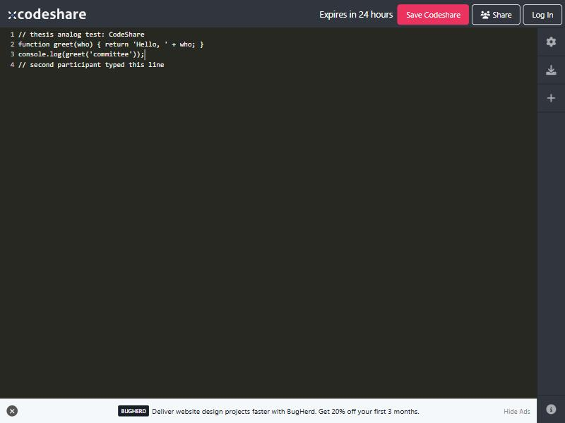
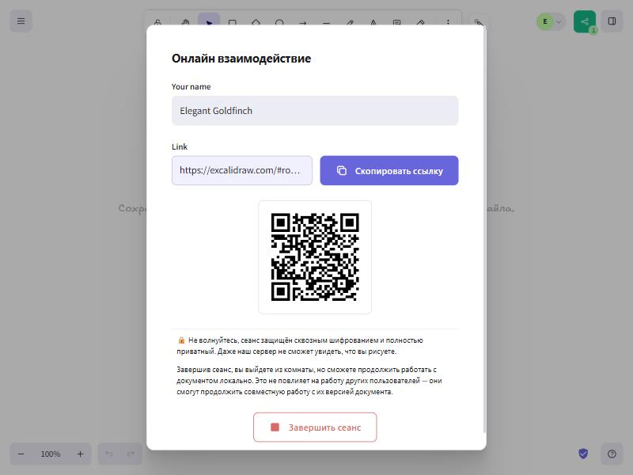
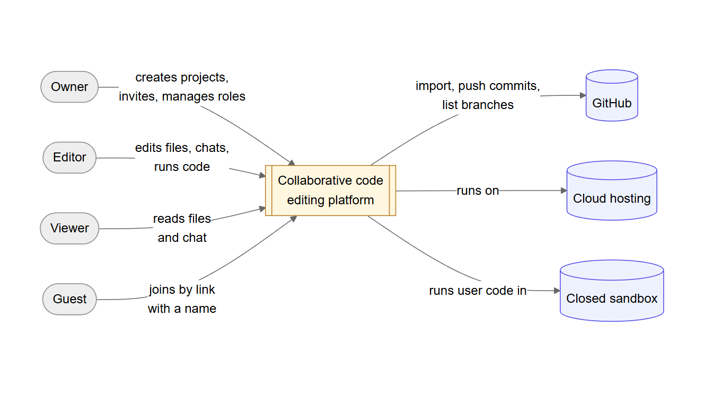
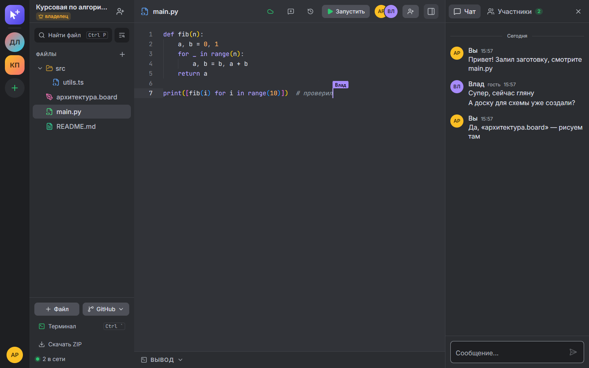
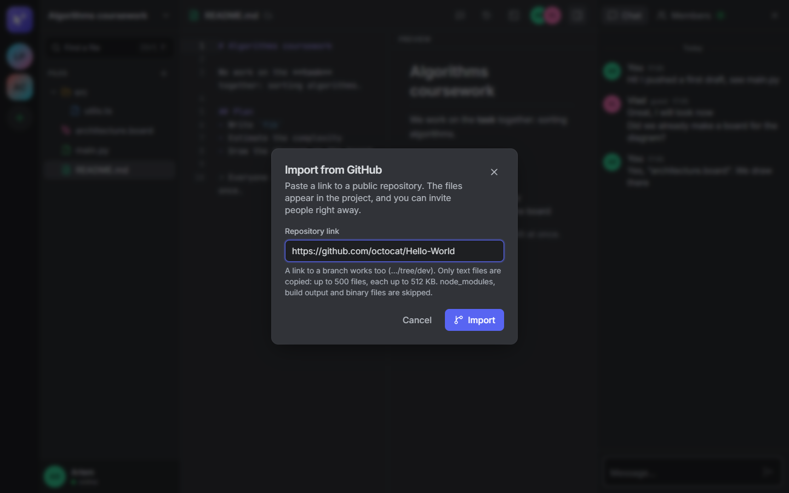

# Introduction

**Relevance and problem.** Many people write software together, but they are not in the same room. In the Stack Overflow Developer Survey 2024, 54,806 people answered a question about their work. Of them, 80% work fully remotely (38%) or in a hybrid mode (42%) [1]. Students work in the same way. They do course projects, talk to lecturers and write code in pairs over video calls. But the tools for *live* work on the same code are separate. A normal session uses many tools. People talk in a messenger or a video call. They show code with screen sharing and send it through GitHub. The task is in one document, and the diagram is on an online whiteboard. Each person needs an invitation to each tool. Many tools need an account or an installed editor. When people change different copies of a file at the same time, they get merge conflicts or lose their work.

This problem affects three groups: **students who work on team tasks, mentors and lecturers who help them, and small development teams** that need a short session together. These people lose time and effort when they start work on the same code, and they can lose their work. The problem is important now for two reasons. First, remote and hybrid work is now normal [1]. Second, the real-time tools on the market have limits: they work with one desktop editor, they need a paid plan, or they show one file without the rest of the project (section 1.3). The cost can be measured. A study of nine open-source projects shows this: one merge in six had a text conflict, and developers had to fix it by hand [2]. Also, experienced users who already have all accounts and tools need about one minute of work before the first shared edit (Appendix D). A partner without an account needs almost two minutes.

**Goal and objectives.** The goal of this work is to design and build a web platform where a small team opens a shared project by a link and works on code, documents and diagrams together in real time, without installing software and without losing edits when the connection stops.

To reach this goal, the work has five objectives:

1. Study how people work on code together today, where they lose time and data, and how existing products solve this.
2. Study the science of real-time editing (Operational Transformation and CRDT) and choose a method that works offline.
3. Write the requirements for the platform: vision, KPIs, stakeholders, scope, epics, user stories, use cases, non-functional requirements, legal and ethical requirements, and risks.
4. Design and build the platform, and check it against the KPIs and the non-functional requirements.
5. Compare OT and CRDT in an experiment on the platform (delay, network traffic, memory, merging after offline work).

**Object and subject.** The *object* of this work is a process: a small team works together on a software project in real time. The team writes and checks code, describes tasks and draws the design. The *subject* is the part of this process that software can do automatically. Software can let people edit the same files at the same time and keep the files the same for everyone. It can show who is online and let people talk. It can also control access, run code in a safe place and exchange the project with a Git repository.

**Methods.** The requirements come from four methods:

- *Document analysis:* scientific papers about shared editing, product documentation, laws and standards (section 1.2).
- *Comparison of analogs:* five existing products were compared on the same criteria. The products that work without registration were tested in two browser windows. Section 1.3 has the screenshots.
- *Process modelling and task analysis:* a UML activity diagram shows the current process (Figure 1.1). The Keystroke-Level Model [3] splits the start of a session into small actions. This model gives a time estimate when there is no data from users (Appendix D).
- *Prototype and experiment:* the requirements became better step by step on a working prototype. An experiment with up to 100 simulated users tested the main technical idea: a CRDT can be as fast as OT.

A questionnaire for students and developers is ready (Appendix C). But nobody has answered it yet, and there were no interviews. So no statement in this document uses survey or interview data. The questionnaire and the pilot sessions (section 2.10) will confirm or correct the estimated baselines (start values).

# 1 Analytical part

## 1.1 Current state of the process

**How the task is solved today.** Sometimes two or more people must work on the same code at the same time. For example: a lab task, a bug that a student cannot fix alone, a talk with a lecturer, or a code review. Usually they build the session from several general tools. The tools and their documentation show this typical AS-IS process (Figure 1.1, full size in Appendix B):

1. The initiator starts a call in a messenger (Discord, Telegram, Zoom, Teams) and shares the screen.
2. The others watch the screen and say what to change. Only the person who shares the screen can edit.
3. When another person needs to edit, the code goes out as a file or to a GitHub repository. The others download it, install dependencies and run it on their computers.
4. People send their changes back as files or commits. Someone merges them by hand and fixes conflicts.
5. The task description is in a separate document (Google Docs). Diagrams are on a separate whiteboard (Miro, FigJam, Excalidraw). Each tool needs its own invitation and often its own account.

**Who is involved.** The initiator is usually a student or a team lead. Other team members take part, and sometimes a lecturer or a mentor. Sometimes an outside person joins, for example a student from another group. This person has no accounts in the team's tools.

**Where time and data are lost.**

- *Start-up time.* Before people can edit together, each person must get access to several tools, install them or sign in, and get the code. A keystroke-level estimate shows the best case: experienced users who make no mistakes. It gives about 1.1 min when everything is ready and about 1.7 min when the partner must first register with the Git host. Installing Git, an editor and a runtime takes extra time (Appendix D).
- *Changing between tools.* The reference session uses five tools: a messenger, a Git host, a local editor, a document and a whiteboard. The talk, the code, the task and the diagram are in different windows, and they are not linked.
- *Lost edits and conflicts.* Copies of the same file become different. Brun et al. studied nine open-source projects. In these projects, 17% of merges had a text conflict, and someone had to fix it by hand [2].
- *People who only watch.* With screen sharing, only one person types. The others cannot point at the code or fix it.
- *"Works on my machine".* Each person runs the code on their own computer with a different setup. So the team does not see the same result.

**TO-BE.** In the new process (Figure 1.2) the initiator creates a project once and sends one invitation link. The others open it in a browser. A guest only enters a name. They all see the same files, each other's cursors and who is online. Code, Markdown documents and a whiteboard are files of one project, and the chat is next to them. The code runs on the server in a sandbox, so everybody sees the same output. The system merges edits automatically, also edits made offline, so nobody merges by hand. After the work, the team can push the project to GitHub.

## 1.2 Review of sources

The sources form four groups: methods of real-time shared editing, the cost of work on separate copies, how users feel the speed of a system, and official documents. Each group had a direct effect on the requirements in Chapter 2.

**Methods of shared editing.** Ellis and Gibbs introduced Operational Transformation (OT) for group editors. OT changes operations that happen at the same time, so all copies become the same [4]. Sun and Ellis showed that correct transformation functions are hard to design. They also showed that real OT systems need a central server to put operations in order [5]. This is fine when everyone is online. But it makes long offline work hard, because the server must transform a long list of edits against everything that happened during this time. Shapiro et al. defined Conflict-free Replicated Data Types (CRDT). Copies of a CRDT always become the same without any central control. This property is called strong eventual consistency [6]. Nicolaescu et al. presented YATA, the algorithm inside the Yjs library. They showed that a CRDT can support almost real-time editing at an acceptable cost for documents of normal size [7]. Kleppmann and Beresford extended CRDTs to data with a JSON-like structure [8]. This model fits data that is not text, such as shapes on a whiteboard, where each property of an object can merge separately.

*Conclusion for the requirements:* people must be able to keep editing when the connection stops (US-09), so a CRDT is better than OT for the main synchronisation. The guarantee of CRDTs [6] is the basis of KPI-3 ("no lost edits"), and the whiteboard uses the object model of [8] (US-12).

**Local-first and recent work.** Kleppmann et al. described *local-first software*: the main copy of the data is on the user's device, the software works offline, and CRDTs make shared work possible [9]. These ideas explain why offline work and automatic merging are useful for users, not only a technical detail. A recent study by Gentle and Kleppmann (EuroSys 2025) shows a weakness of classic text CRDTs: their metadata grows with the editing history. The study gives an algorithm that uses less memory and loads faster [10]. *Conclusion:* the growth of the document state is a project risk (R4 in section 2.9), and the experiment measures it. The implementation follows the Yjs documentation [11].

**The cost of separate copies and of starting a session.** Brun et al. studied nine open-source systems with 3.4 million lines of code. One merge in six (17%) had a text conflict. Conflicts were frequent and lasted a long time [2]. Their answer is to warn developers earlier. This work removes the cause, because there is only one shared copy. The figure is per merge in long projects, not per live session. So it is the closest published baseline, not an exact one. *Conclusion:* it sets the baseline of KPI-3, and automatic merging is a Must story (US-09). The Keystroke-Level Model of Card, Moran and Newell estimates the time that an expert needs for a routine task. It adds the times of small actions and needs no test users [3]. It counts work without errors, so the result is a lower limit. *Conclusion:* KPI-1 has an estimated baseline now (Appendix D), and the pilot will replace it with a measured value.

**Quality of interactive systems and standards.** Nielsen says that users feel a reaction as instant if it takes 0.1 s or less [12]. *Conclusion:* the delay of an edit has a limit of 100 ms at the 95th percentile (NFR-P1, KPI-4). ISO/IEC 25010:2023 defines a product quality model [13]. Its characteristics give the structure of the non-functional requirements in section 2.7: performance efficiency, security, reliability (availability) and interaction capability (usability). The General Data Protection Regulation (GDPR) [14] decides how the system may process account data, chat messages and survey answers (section 2.8). WCAG 2.1 [15] gives the accessibility level for the interface. The OWASP Top 10 [16] lists the web risks that the security requirements cover (broken access control, cryptographic failures, injection).

## 1.3 Analysis of analogs

This section compares five products: three commercial products (VS Code Live Share, Replit, CodeShare.io) and two open-source projects (the Yjs framework for shared editing and the Excalidraw whiteboard). CodeShare.io, Yjs and Excalidraw were tried in practice: a session was opened in one browser tab and joined from a second tab, and edits were made in both tabs (Figures 1.3–1.5). Live Share and Replit need an account, so their properties come from the official documentation [17], [18].

**VS Code Live Share** [17] shares a project that is open in the host's VS Code or Visual Studio. Guests can edit and debug together, and use shared terminals and servers. People normally sign in with a Microsoft or GitHub account. Anonymous guests can join only in read-only mode, and the host must approve them. The data is end-to-end encrypted. The session exists only while the host is online, because the files are on the host's computer.

**Replit** [18] is a browser IDE with collaboration built in. The owner invites teammates by e-mail or by a private link. Collaboration seats are part of the paid plans (5 seats on Core, 15 on Pro). The project, the running environment and the AI assistant are in the cloud.

**CodeShare.io** [19] opens a shared editor without registration (Figure 1.3). Text typed in a second browser tab appeared in the first tab at once. But the document is one file without a project structure. The code cannot run, and people are anonymous (there are no names at the cursors). An unsaved document disappears after 24 hours if the owner does not create an account.

**Yjs** [11] is an open-source CRDT framework that connects to popular editors. Its public Monaco demo (Figure 1.4) shows real-time editing with the cursors of other people. But it is a building block, not a product: it has no projects, accounts, permissions, chat or code execution.

**Excalidraw** [20] is an open-source (MIT) whiteboard. It has "live collaboration" by link, with end-to-end encryption and without registration (Figure 1.5). It covers only the diagrams of a session. The drawing is stored in the browser, and there is no code, no documents and no project members.

Table 1.1 compares the products on eight criteria.

Table 1.1 — Comparison of analogs

| Criterion | Live Share | Replit | CodeShare.io | Yjs (demo) | Excalidraw | Proposed platform |
|---|---|---|---|---|---|---|
| Works in a browser without installation | No (host needs VS Code) | Yes | Yes | Yes | Yes | Yes |
| Join without an account | Read-only, with approval | No | Yes | Yes | Yes | Yes (guest by link) |
| Project with many files and roles | Yes | Yes | No | No | No | Yes |
| Code, documents and whiteboard in one place | Code only | Code (+ AI) | Code only | Text only | Whiteboard only | Code, Markdown, whiteboard |
| Run code together | Yes (host's computer) | Yes | No | No | — | Yes (server sandbox) |
| Offline work with automatic merge | No | No | No | Yes (library) | No | Yes |
| Session continues when the initiator leaves | No | Yes | Yes (24 h) | Yes | Yes | Yes |
| Free collaboration | Yes | Paid plans | Yes (24 h) | Yes | Yes | Yes (self-hosted) |

**What is missing.** No analog has all three things that the use cases need: (1) *easy entry*: a browser link with write access, without an account or installation; (2) *a permanent project with many files*, where code, documents, diagrams, chat and code execution are together; (3) *editing that works offline* and merges automatically. Live Share and Replit have rich projects, but they need accounts, and Replit collaboration needs a paid plan. The simple tools need nothing, but they lose the project, the names of people and, after 24 hours, the data. Yjs shows that the technology exists, but it is not a ready solution.

## 1.4 Chapter conclusions

The analysis found the problems in Table 1.2. Each problem is linked to a future epic and KPI.

Table 1.2 — Problems, epics and KPIs

| ID | Problem | Epic | KPI |
|---|---|---|---|
| P1 | To start a session, people need invitations, accounts and installations in several tools | E1 Access and projects | KPI-1 Time to collaborate |
| P2 | A session uses several tools that are not connected | E3 Documents and whiteboard, E4 Communication, E5 Code execution, E6 GitHub | KPI-2 Tools per session |
| P3 | Copies become different; edits are lost or must be merged by hand | E2 Real-time co-editing, E7 Files and history | KPI-3 Lost edits |
| P4 | Only the person who shares the screen can type; the others only watch | E2 Real-time co-editing | KPI-4 Edit latency |
| P5 | Code runs on different computers with different results | E5 Code execution | KPI-2 Tools per session |

The new solution must do these things: open a permanent project by a link in a browser, also for guests without an account; let several people edit code, Markdown documents and a whiteboard at the same time, with visible cursors and a list of who is online; keep working when the connection stops and merge the edits automatically; run code in a shared sandbox with the same output for everyone; exchange the project with GitHub.

# 2 System requirements

## 2.1 Vision and goals

**Vision.** The platform is for students, mentors and small development teams who need to work on the same code together. It is a browser workspace that opens by one link, where people share code, documents, diagrams, chat and code execution in real time. Guests need no installation or account, unlike with screen sharing and desktop tools, and the platform never loses an edit, even when the connection stops.

**Business goals.**

- G1: Reduce the time to start a session to about one minute.
- G2: Replace a set of separate tools with one workspace.
- G3: Remove lost edits and merging by hand in live sessions.
- G4: Make shared editing feel instant for a normal team and for a class-sized group.

Table 2.1 shows the KPIs for these goals. There is no user data yet. So the baselines come from the process model and the task analysis (KPI-1, KPI-2) and from the literature (KPI-3, KPI-4). The table gives the source of each one. A pilot with five pairs of people and automated tests will check the target values (section 2.10).

Table 2.1 — KPIs with baseline and target values

| KPI | Goal | Definition | Baseline | Target | How measured |
|---|---|---|---|---|---|
| KPI-1 Time to collaborate | G1 | Time from the start of an invitation until both people edit the same file | About 1.1 min when ready, 1.7 min without an account; estimated lower limit (Appendix D) | ≤ 1 min in ≥ 90% of pilot sessions | Pilot sessions with a timer |
| KPI-2 Tools per session | G2 | Number of separate apps or sites for text chat, code, the task and a diagram (voice calls are out of scope, section 2.3) | 5 (reference process, Figure 1.1) | 1 | Questionnaire after the session |
| KPI-3 Lost edits | G3 | Share of merges of parallel work that lose edits or need a merge by hand | 17% of merges [2] | 0; all copies become identical in 100% of automated tests | Pilot log, convergence tests |
| KPI-4 Edit latency | G4 | 95th percentile of the time between an edit and its appearance for other people | 100 ms limit of perception [12] | ≤ 100 ms with 50 editors at the same time | Load test with simulated users |

The same method gives about 0.5 min for the platform. The KPI-1 target of 1 min leaves extra time, because real first-time users are slower than the experts in the model.

## 2.2 Stakeholders and users

Table 2.2 — Stakeholders

| Stakeholder | Interest | Influence |
|---|---|---|
| Student developer (team member) | Start work quickly, not lose edits, run code together | M |
| Team lead / project owner (student) | Control who can edit, keep the project in one place, push to GitHub | M |
| Lecturer / mentor | Join a student's project for a consultation, see and correct the code live | M |
| Guest participant (classmate, interviewer) | Join once by a link without registration | L |
| Author and developer of the platform | Finish the system within the diploma time and resources | H |
| Diploma supervisor and committee | Relevance of the problem, quality of the requirements and the solution | H |
| Operator of a hosted instance (e.g. university IT) | Security of running user code, cost, personal data rules | M |
| GitHub (external system) | API use within rate limits and terms of service | L |

**System users (actors in the scenarios).** *Owner* creates a project, invites people and manages roles. *Editor* edits files and runs code. *Viewer* can only read. *Guest* joins by a link with only a name and gets the role from the link. *Registered user* has an e-mail account and a list of projects. Roles have an order: owner > editor > viewer.

**Personas.** Both personas are examples made from the process analysis. They are not real people, and their words are only examples.

*Anna, 20, second-year Computer Science student.* Works on a team task with three classmates, mostly in the evening at home. Uses Discord for calls and GitHub for code, but half of the team does not know Git well. Main problem: "Before we start, we spend fifteen minutes sending files and fixing merge conflicts." Needs: one link for the whole team, everyone typing at the same time, the task next to the code.

*Dmitry, 38, lecturer and mentor.* Gives online consultations to students. Wants to open a student's code in a second, point at a line, fix it and run it. The student should not install anything or share the screen. Main problem: "I can only watch the screen and say what to change." Needs: guest access by link, visible cursors, running code with the same output for both.

## 2.3 Project scope

**In scope.** Accounts (registration, sign-in, guest access); projects with members, roles and invitation links; a file tree with code files, Markdown documents and whiteboards; real-time shared editing with cursors, a list of who is online and offline merge; a project chat; running JavaScript and Python in a sandbox with shared output and an interactive terminal; trash, version history, search; import of a public GitHub repository, pushing changes as a commit and changing branches; a web interface for all screen sizes; deployment settings for a cloud environment and a local test host for demonstrations; REST API documentation (OpenAPI).

**Out of scope.** Voice and video calls (a separate WebRTC system, not related to the research question; teams keep their usual call tool); a step-by-step debugger; a full Git client (merging, pulling the changes of other people, deleting files in the repository); import of private repositories; desktop or mobile apps; advanced design tools (pen tool, components, prototyping); payments and subscriptions.

Table 2.3 — Assumptions and constraints

| Type | Description |
|---|---|
| Deadline | The BA block is due on 30 October 2026. The defense is on 9–17 November 2026. The final thesis follows the department schedule |
| Resources | One developer; work on a personal computer with Docker; no money for paid services, so demonstrations run on a local test host and any cloud deployment stays small |
| Access to APIs | The GitHub REST API allows 60 requests per hour per IP without a token. Above this limit, the system uses the user's own token and never stores it on the server |
| Access to data | No real user data is available or needed. Tests use generated accounts. Survey answers, when collected, are anonymous |
| Technology | Users have a modern browser (last two versions of Chrome, Firefox, Edge, Safari). Code execution needs Docker on the server |

## 2.4 Solution concept

The platform is a web application (Figure 2.1). A user works in the browser. The client application talks to three parts: a REST API (accounts, projects, files, chat, runs), a synchronisation server, and a terminal endpoint. The synchronisation server keeps the shared documents (a CRDT, Yjs) and sends edits, cursors and the list of people online over WebSocket. A runner service runs code in isolated Docker containers. A relational database stores projects, members, files, messages and versions. A message broker works with queues and events. The external systems are GitHub (import, push, branches) and the cloud hosting provider.

Before this choice, two other options were compared (Table 2.4).

Table 2.4 — Alternatives of the solution

| Criterion | A1: Add-on for an existing editor (like Live Share) | A2: Own web platform with OT (ShareDB) | Chosen: own web platform with CRDT (Yjs) |
|---|---|---|---|
| Entry for guests | Editor installation, account | Browser link | Browser link |
| Offline editing | Not supported | Limited: the server must transform long lists of edits | Built in: copies merge without a central server |
| Session without the initiator | No (files are on the host) | Yes | Yes |
| Non-text data (whiteboard) | Not covered | Needs a separate OT type | Shared types (maps, arrays) of the same library |
| Measured edit delay, p95, 50 users (one machine, loopback) | — | about 9 ms, up to 12.3 ms in one run | about 10 ms, up to 11.1 ms in one run |
| Risk | Depends on a closed platform | Complex transformation logic | Document state grows (R4) |

*Reason for the choice.* A1 cannot give easy entry and a permanent project (P1). A2 and the chosen option have the same delay in the experiment of this work: about 10 ms at the 95th percentile with 50 users, in three runs on one machine over loopback, so network delay is not included. But a CRDT supports offline editing and the whiteboard directly. So the CRDT is the choice, and its weakness, a larger document state, is managed as a risk.

## 2.5 Functional requirements

The functional requirements form seven epics (Table 2.5) and 27 user stories with MoSCoW priorities. The full backlog with acceptance criteria is in Appendix A. This section lists the epics, the key stories and the traceability from goals to stories.

Table 2.5 — Epics

| Epic | Description | Stories | Goal |
|---|---|---|---|
| E1 Access and projects | Accounts, guest access, projects, invitations, roles | US-01 – US-06, US-27 | G1 |
| E2 Real-time co-editing | Editing at the same time, cursors, list of people online, offline merge | US-07 – US-10 | G3, G4 |
| E3 Documents and whiteboard | Markdown with preview, shared whiteboard | US-11, US-12 | G2 |
| E4 Communication | Project chat | US-13 | G2 |
| E5 Code execution | Running code in a sandbox, terminal, access code | US-14 – US-16 | G2 |
| E6 GitHub integration | Import, push, branches | US-17 – US-19 | G2 |
| E7 Files and history | File tree, trash, version history, search | US-20 – US-23 | G3 |

Things that are out of scope are written as *Won't* stories (US-24 – US-26), so the decision is visible.

Table 2.6 — Key user stories (from Appendix A)

| ID | User story | MoSCoW |
|---|---|---|
| US-02 | As a project owner, I want to invite people with a link, so that they can join without any setup. | Must |
| US-03 | As a guest, I want to join a project by a link and enter only my name, so that I can start without registration. | Must |
| US-07 | As an editor, I want to edit the same file at the same time as others and see their changes at once, so that we work like at one screen. | Must |
| US-08 | As a participant, I want to see the cursors and names of others and who is online, so that we do not edit the same place by accident. | Must |
| US-09 | As a participant with a bad connection, I want to keep editing offline and have my edits merged automatically, so that I lose no work. | Must |
| US-14 | As an editor, I want to run a JavaScript or Python file in a sandbox and see the output together with others, so that we check the same result. | Should |
| US-12 | As a team member, I want a shared whiteboard with shapes, text and arrows, so that we can draw the design next to the code. | Should |

**Acceptance criteria of key Must stories (Given/When/Then).**

*US-03 Join as a guest.*
**Given** a valid invitation link with the role "editor" and a visitor who is not signed in,
**When** the visitor opens the link, enters a name and confirms,
**Then** the visitor becomes a member with the role "editor", and the project opens on a file within 5 seconds.
**Given** an invitation link that the owner has replaced,
**When** a visitor opens the old link,
**Then** the system shows "the invitation is invalid or expired" and creates no membership.

*US-07 Edit a file together.*
**Given** two editors who have the same file open,
**When** one of them types a line,
**Then** the line appears in the other editor within 100 ms (95th percentile, NFR-P1), and both copies are identical after the edits stop.

*US-08 Cursors and the list of people online.*
**Given** two participants in the same project,
**When** one of them moves the cursor in a file,
**Then** the other sees a cursor with the name of the first participant at that position, and both are in the list of people online.

*US-09 Offline editing.*
**Given** an editor who loses the connection while a file is open,
**When** the editor keeps typing and the connection comes back,
**Then** the system merges the offline edits and the edits of others automatically, without a conflict dialog and without losing any character.

**Mockups of key stories.** Figures 2.2–2.5 show the layouts of four key stories. They are screenshots of the working prototype, and its interface language is Russian. Full-size copies are in Appendix B.

**Traceability.** Table 2.7 links each business goal to its KPI, epics and the Must and Should stories.

Table 2.7 — Traceability goal → KPI → epic → story

| Goal | KPI | Epic | Stories |
|---|---|---|---|
| G1 Fast start | KPI-1 | E1 | US-01, US-02, US-03, US-04, US-05 (Must); US-06, US-27 (Should) |
| G2 One workspace | KPI-2 | E3, E4, E5, E6 | US-11, US-12, US-13, US-14, US-17 (Should); US-15, US-16, US-18, US-19 (Could) |
| G3 No lost edits | KPI-3 | E2, E7 | US-09, US-20 (Must); US-21, US-22, US-23 (Should) |
| G4 Instant co-editing | KPI-4 | E2 | US-07, US-08 (Must); US-10 (Should) |

## 2.6 Use case scenarios

**UC-1 Join a project by invitation and co-edit a file**

- *Actor:* Guest (also: Owner, other participants).
- *Precondition:* the owner has created a project and shared an invitation link with the role "editor". The guest has a browser and is not signed in.
- *Postcondition:* the guest is a member of the project, and all participants see the edits of the guest.
- *Main flow:*
  1. The guest opens the invitation link.
  2. The system shows the project name, the person who invites and the role from the link.
  3. The guest enters a name and confirms.
  4. The system creates a guest account, adds the guest to the project with the role from the link and opens the project on a start file.
  5. The guest types in the file.
  6. The system sends the edits to all participants who have the file open and shows the cursor of the guest with the name. The guest appears in the list of people online.
- *Alternative flows:*
  - A1 (step 2): the link is invalid or was replaced. The system shows an explanation and a link to the guest's own projects. The use case ends.
  - A2 (step 1): the visitor is already signed in. The system adds the membership and opens the project. Steps 2–3 do not happen.
  - A3 (step 4): the link gives the role "viewer". The project opens in read-only mode, the editor shows "read only", and step 5 is not possible.

Appendix B has the system sequence diagram of UC-1 (Figure B.5).

**UC-2 Run code and share the result**

- *Actor:* Editor (also: other participants).
- *Precondition:* the editor has a JavaScript or Python file open. Code execution is turned on at the server.
- *Postcondition:* all participants see the output, the status and the duration of the run.
- *Main flow:*
  1. The editor presses "Run".
  2. The system takes the current text of the file and the other text files of the project and puts a run in the queue.
  3. The system runs the program in an isolated container without network access.
  4. The system sends the output to all participants who have the file open.
  5. The system shows the status ("finished" or "error") and the duration. If there is an error, it highlights the line with the error.
- *Alternative flows:*
  - A1 (step 3): the program runs longer than 10 s. The system stops the container and shows the status "timeout".
  - A2 (step 1): the server is a public test host with an access code. The system asks for the code once and continues after a correct code.

Appendix B has the activity diagram of UC-2 (Figure B.6).

## 2.7 Non-functional requirements

The non-functional requirements follow the quality characteristics of ISO/IEC 25010:2023 [13]. Each one has a measurable indicator and a link to KPIs and stories (Table 2.8).

Table 2.8 — Non-functional requirements

| ID | Category | Requirement and measurable indicator | KPI / stories |
|---|---|---|---|
| NFR-P1 | Performance | Edit delay ≤ 100 ms at the 95th percentile with 50 editors of one document at the same time | KPI-4; US-07, US-08 |
| NFR-P2 | Performance | A project with up to 200 files opens (file tree and first file) in ≤ 3 s on a 10 Mbit/s connection | KPI-1; US-03 |
| NFR-P3 | Performance | Output of a simple program appears in ≤ 3 s after pressing "Run"; the system stops any run after 10 s | US-14 |
| NFR-S1 | Security | The system stores passwords only as Argon2id hashes; access tokens live 15 min, refresh tokens live 30 days and change at every use | US-05 |
| NFR-S2 | Security | Every REST and WebSocket request checks project membership and role; a non-member gets 404 (on a WebSocket, close code 4403); removed members lose open connections within 5 s | US-04 |
| NFR-S3 | Security | User code runs without network, with a read-only file system, ≤ 0.5 CPU, as a user without special rights; a run has ≤ 128 MB memory and ≤ 64 processes, the interactive terminal ≤ 256 MB and ≤ 128 processes | US-14, US-15 |
| NFR-S4 | Security | On a public instance, sign-in and registration have a limit of 20 requests per minute per IP; code execution needs an access code | US-05, US-16 |
| NFR-A1 | Availability | A hosted instance works ≥ 99% of a calendar month (≤ 7.3 h without service), not counting planned maintenance | KPI-1 |
| NFR-A2 | Availability | Edits made without a connection stay on the device and merge after reconnection with 0 lost characters | KPI-3; US-09 |
| NFR-U1 | Usability | ≥ 4 of 5 first-time pilot participants join as guests and make their first edit within 60 s without instructions | KPI-1; US-03 |
| NFR-U2 | Usability | The interface works at screen widths from 360 px to 1920 px | US-03, US-07 |
| NFR-U3 | Usability | Text contrast ≥ 4.5:1 and all main actions work from the keyboard (WCAG 2.1 AA, criteria 1.4.3 and 2.1.1) | Section 2.8 |

## 2.8 Legal and ethical requirements

**Personal data and the legal basis (GDPR [14]).** The platform processes this personal data: the e-mail address and name of registered users; the name of guests (no e-mail); password hashes; refresh tokens; IP addresses in technical logs; any personal data that users write in files and chat messages. There are two legal bases. Performance of a contract (Art. 6(1)(b)) covers account and project data, because the user signed up for the service. Legitimate interest in security (Art. 6(1)(f)) covers logs and rate limits. These requirements follow from the principles of Art. 5 and the rights of data subjects:

- data minimisation: guests have no e-mail, and the system uses no analytics or tracking cookies;
- storage limitation: the system removes deleted files after 30 days, and refresh tokens expire after 30 days;
- right to erasure, or deletion of data (Art. 17): a user can delete the account and personal data (US-27, Should; implemented: the system deletes the account, the messages of the user and owned projects, and the offline copies in the browser);
- security of processing (Art. 32): TLS for all connections, hashed passwords, role checks (NFR-S1–S4);
- a privacy notice is open to everyone, with links from the sign-in, registration and invitation pages;
- a production instance is hosted in the EU/EEA.

**Consent of survey and interview participants.** This work has not collected any data from participants yet. The prepared questionnaire is anonymous, does not ask for names or e-mail addresses, and starts with a clear consent question (Art. 6(1)(a)). Each interview or pilot session starts with oral consent, and the notes contain no names. Only summary results are published.

**Licences.** The platform uses open-source components with licences that allow free use (Yjs, Hocuspocus, Monaco Editor, React, Konva and xterm.js under MIT; Prisma under Apache 2.0) and the Inter and JetBrains Mono fonts under the SIL Open Font License. Their licence notices stay in place. User code runs in official Node.js and Python Docker images. Files imported from GitHub keep the licence of the source repository, and the platform does not change it.

**Standards.** The interface aims at WCAG 2.1 level AA [15] for contrast and keyboard access (NFR-U3). The security requirements cover the relevant OWASP Top 10 categories [16]: broken access control (NFR-S2), cryptographic failures (NFR-S1) and injection (safe database queries, code execution in a sandbox, NFR-S3).

## 2.9 Risks

Table 2.9 — Project risks (P is probability, I is impact: H/M/L)

| ID | Risk | P | I | Mitigation | Dependency |
|---|---|---|---|---|---|
| R1 | The estimated KPI baselines differ from real user experience | M | M | Run the prepared questionnaire and the pilot; report n and ranges, not only medians; give the source of each baseline | KPI-1 – KPI-3 |
| R2 | People abuse code execution or escape from the sandbox on a hosted instance | L | H | Container limits (NFR-S3), no network, access code on public hosts, an option to turn execution off | E5, NFR-S3 |
| R3 | GitHub API rate limits block import and branch changes | H | M | Use the user's token for API calls, download archives via codeload, clear error messages | E6 |
| R4 | The CRDT document state grows with the editing history and makes opening slower | M | M | Measure the state size in the experiment; snapshots; follow newer algorithms [10] | KPI-4, NFR-P2 |
| R5 | One developer and a fixed deadline: the scope does not fit | M | H | MoSCoW: drop Could stories first; build and test Must stories first | All epics |
| R6 | Cloud costs are higher than the free tier | M | M | Deployment on one host, local test hosting for demonstrations | NFR-A1 |
| R7 | Personal data leak (accounts, chat) | L | H | Hashing, TLS, minimisation, role checks, dependency updates | Section 2.8 |

The part of the project with the highest risk is code execution (R2). It is the only feature that runs unknown code on the server. Container limits keep this code away from the server, the operator can turn execution off, and public test hosts ask for an access code that only the operator knows.

## 2.10 Chapter conclusions

The requirements specification fixes these things: the vision and four business goals with KPIs and baselines; the stakeholders, actors and personas; the scope with assumptions and constraints; the solution concept (a web platform with a CRDT), chosen over two alternatives; 27 user stories in seven epics with MoSCoW priorities and acceptance criteria; two use case scenarios with a system sequence diagram and an activity diagram; twelve non-functional requirements with measurable indicators; the legal and ethical requirements; and seven risks with mitigations.

The result is checked against the KPIs of section 2.1 and the key NFRs (Table 2.10). Things that need real users, above all the pilot, are not done yet. Things that a machine can check are already done.

Table 2.10 — Evaluation criteria linked to the KPIs

| KPI / NFR | Criterion | Method | Status at the time of writing |
|---|---|---|---|
| KPI-1, NFR-U1 | ≤ 1 min in ≥ 90% of sessions; ≥ 4 of 5 first-time participants make an edit within 60 s | Pilot with five pairs and a timer | Pilot not done; estimate 0.5 min (Appendix D) |
| KPI-2 | 1 tool per session | Questionnaire after the pilot session | Pilot not done |
| KPI-3, NFR-A2 | No merges by hand, 0 lost characters, all copies identical | Automated convergence and offline tests; pilot log | Automated tests pass; pilot not done |
| KPI-4, NFR-P1 | p95 ≤ 100 ms with 50 editors | Load test with simulated users | About 10 ms on one machine over loopback, without network delay |
| NFR-P2 | 200 files open in ≤ 3 s at 10 Mbit/s | Measurement by a script in a browser | 2.0 s (median of 10 runs, simulated network, server on the same machine) |
| Must stories | Acceptance criteria of Appendix A | Automated end-to-end tests | 40 scenarios pass |
