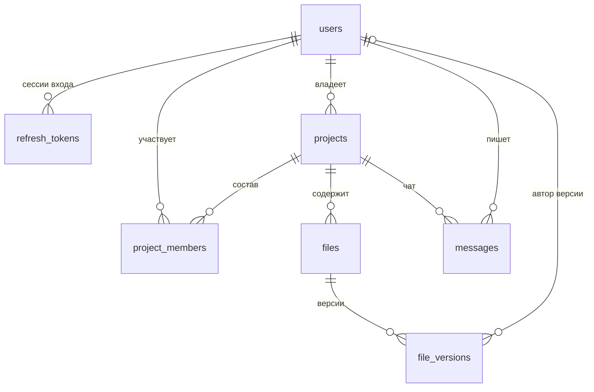

# База данных

Материалы по критерию Database. СУБД — PostgreSQL 16, доступ из кода — Prisma ORM.

| Что | Где |
|---|---|
| Словарь данных: таблицы, поля, типы, ключи | [`data-dictionary.md`](data-dictionary.md) |
| Логическая схема (ER-диаграмма) | [`er-diagram.png`](er-diagram.png), исходник [`er-diagram.mmd`](er-diagram.mmd) и ниже на этой странице |
| Миграции (источник структуры) | [`packages/db/prisma/migrations`](../../packages/db/prisma/migrations) |
| Схема Prisma | [`packages/db/prisma/schema.prisma`](../../packages/db/prisma/schema.prisma) |
| Полный DDL итоговой структуры одним файлом | [`schema.sql`](schema.sql) |

## Как создаётся база

Структура создаётся только скриптами. Вручную в базе ничего не создаётся.

1. Запустить PostgreSQL. Для разработки он есть в Docker Compose:

   ```bash
   docker compose -f infra/docker-compose.dev.yml up -d
   ```

2. Указать адрес базы. Пример лежит в `packages/db/.env.example`:

   ```bash
   cp packages/db/.env.example packages/db/.env
   ```

3. Применить миграции.

   ```bash
   pnpm install
   pnpm db:migrate                                # разработка: prisma migrate dev
   pnpm --filter @collab/db migrate:deploy        # сервер: prisma migrate deploy, без вопросов
   ```

`prisma migrate deploy` применяет по порядку только те миграции из папки
`packages/db/prisma/migrations`, которых ещё нет в базе. Выполненные миграции Prisma отмечает в
служебной таблице `_prisma_migrations`. На сервере это делает отдельный сервис `migrate` в
[`infra/docker-compose.yml`](../../infra/docker-compose.yml) перед запуском API.

Файл `schema.sql` получен из схемы командой `pnpm db:schema-sql`
(`prisma migrate diff --from-empty --to-schema-datamodel`). Он нужен, чтобы прочитать всю структуру
одним файлом. Для создания базы используются миграции.

## Миграции

| Миграция | Что меняет |
|---|---|
| `20261001193251_init` | Таблицы `users`, `refresh_tokens`, `projects`, `project_members`, `files`, `messages`, типы `ProjectRole` и `FileKind` |
| `20261001200000_add_invite_links_and_guests` | Гости (`users.is_guest`), ссылки-приглашения (`projects.invite_code`, `invite_role`) |
| `20261004120000_add_github_link` | Связь проекта с репозиторием GitHub, `files.source_sha` |
| `20261005120000_add_file_trash` | Корзина: `files.deleted_at`, `trashed_path` |
| `20261006120000_files_per_branch` | У каждой ветки свои файлы: `files.branch`, новый ключ уникальности |
| `20261007120000_file_versions` | История версий: таблица `file_versions` |
| `20261104120000_refresh_token_lookup_and_email_case` | Индекс по `token_hash`, адреса в нижнем регистре |

## Логическая схема



Подробно, с полями и типами, — на [`er-diagram.png`](er-diagram.png) и в словаре данных.

Сущности:

- **users** — зарегистрированные пользователи и гости.
- **refresh_tokens** — сессии входа, по одной на устройство.
- **projects** — проекты с владельцем, ссылкой-приглашением и связью с GitHub.
- **project_members** — кто в каком проекте и с какой ролью (связь «многие ко многим»).
- **files** — файлы проекта: код, документы, доски. Содержимое — состояние CRDT-документа Yjs.
- **file_versions** — прежние версии файлов в виде текста.
- **messages** — чат проекта.

## Решения по структуре

- **Нормализация.** Таблицы в третьей нормальной форме: у каждой одна сущность, неключевые поля
  зависят только от ключа. Роль хранится в связи `project_members`, а не в `users`, потому что у
  одного человека в разных проектах разные роли.
- **Содержимое файла — двоичное состояние Yjs** (`BYTEA`), а не текст. Так при правке без сети
  изменения сливаются без конфликтов. Версии для просмотра хранятся отдельно, обычным текстом.
- **Удаление.** Удаление проекта каскадно удаляет участников, файлы, версии и сообщения. Пользователя
  с проектами и сообщениями база удалить не даст (`RESTRICT`): приложение при удалении аккаунта
  сначала удаляет его сообщения и проекты в одной транзакции. У версий автор становится `NULL`.
- **Безопасность.** В базе нет паролей и ключей в открытом виде: пароль — хеш Argon2id, ключ
  обновления — SHA-256. Гости не дают e-mail: у них служебный адрес.
- **Redis** в проекте тоже есть, но он хранит только очередь запусков кода и сообщения между
  серверами. Данных предметной области в нём нет, поэтому в схему он не входит.

## Ключи и пароли в репозитории

В Git нет настоящих ключей и паролей. В репозитории лежат только файлы-примеры `.env.example` и
`infra/.env.prod.example`. В них локальные значения для Docker на своей машине (`collab:collab`) или
заглушки `CHANGE_ME`. Настоящие файлы `.env` перечислены в `.gitignore` и в репозиторий не попадали.
