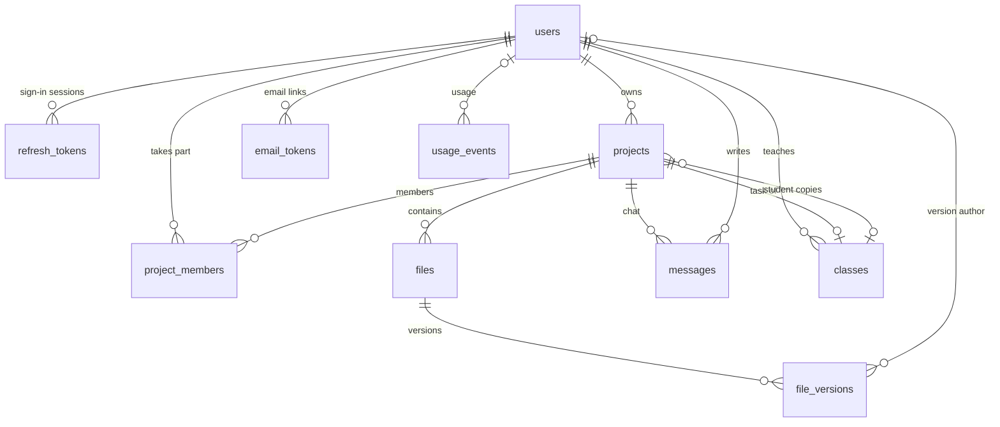

# Database

Materials for the Database criterion. The database is PostgreSQL 16; the code talks to it through Prisma ORM.

| What | Where |
|---|---|
| Data dictionary: tables, columns, types, keys | [`data-dictionary.md`](data-dictionary.md) |
| Logical schema (ER diagram) | [`er-diagram.png`](er-diagram.png), source [`er-diagram.mmd`](er-diagram.mmd), and below on this page |
| Migrations (the source of the structure) | [`packages/db/prisma/migrations`](../../packages/db/prisma/migrations) |
| Prisma schema | [`packages/db/prisma/schema.prisma`](../../packages/db/prisma/schema.prisma) |
| Full DDL of the final structure in one file | [`schema.sql`](schema.sql) |

## How the database is created

The structure is created only by scripts. Nothing is created by hand.

1. Start PostgreSQL. For development it runs in Docker Compose:

   ```bash
   docker compose -f infra/docker-compose.dev.yml up -d
   ```

2. Set the database address. There is an example in `packages/db/.env.example`:

   ```bash
   cp packages/db/.env.example packages/db/.env
   ```

3. Apply the migrations:

   ```bash
   pnpm install
   pnpm db:migrate                                # development: prisma migrate dev
   pnpm --filter @collab/db migrate:deploy        # server: prisma migrate deploy, no questions asked
   ```

`prisma migrate deploy` applies, in order, only the migrations from `packages/db/prisma/migrations`
that the database does not have yet. Prisma records the applied ones in its own table
`_prisma_migrations`. On the server this is done by a separate `migrate` service in
[`infra/docker-compose.yml`](../../infra/docker-compose.yml) before the API starts.

The CI pipeline (`.github/workflows/ci.yml`) also applies all migrations to an empty database on
every push, so a broken migration is caught at once.

`schema.sql` is generated from the schema with `pnpm db:schema-sql`
(`prisma migrate diff --from-empty --to-schema-datamodel`). It is there so the whole structure can be
read in one file. The database itself is created by the migrations.

## Migrations

| Migration | What it changes |
|---|---|
| `20261001193251_init` | Tables `users`, `refresh_tokens`, `projects`, `project_members`, `files`, `messages`; types `ProjectRole` and `FileKind` |
| `20261001200000_add_invite_links_and_guests` | Guests (`users.is_guest`), invite links (`projects.invite_code`, `invite_role`) |
| `20261004120000_add_github_link` | Link from a project to a GitHub repository, `files.source_sha` |
| `20261005120000_add_file_trash` | Trash: `files.deleted_at`, `trashed_path` |
| `20261006120000_files_per_branch` | Each branch has its own files: `files.branch`, new unique key |
| `20261007120000_file_versions` | Version history: table `file_versions` |
| `20261104120000_refresh_token_lookup_and_email_case` | Index on `token_hash`, emails in lower case |
| `20261115120000_email_verification` | Email confirmation and password reset: `users.email_verified_at`, table `email_tokens`, type `EmailTokenKind` |
| `20261115130000_classes` | Classes: table `classes`, `projects.class_id` |
| `20261115140000_usage_events` | Usage statistics: table `usage_events` |
| `20261115150000_github_sign_in` | Sign-in with GitHub: `users.github_id` |

## Logical schema



The full diagram with columns and types is in [`er-diagram.png`](er-diagram.png) and in the data dictionary.

Entities:

- **users**: registered users and guests.
- **refresh_tokens**: sign-in sessions, one per device.
- **projects**: projects with an owner, an invite link and an optional GitHub link.
- **project_members**: who is in which project and with which role (a many-to-many link).
- **files**: project files: code, documents and boards. The content is the state of a Yjs CRDT document.
- **file_versions**: earlier versions of files as plain text.
- **messages**: the project chat.
- **email_tokens**: one-time links for confirming the address and resetting the password.
- **classes**: a teacher's class; students get their own copies of the task project.
- **usage_events**: usage statistics, kept on this server and deleted after 180 days.

## Design decisions

- **Normalization.** The tables are in third normal form: each table holds one entity, and non-key
  columns depend only on the key. The role is stored in `project_members`, not in `users`, because one
  person has different roles in different projects.
- **File content is binary Yjs state** (`BYTEA`), not text. This way offline edits merge without
  conflicts. Versions for viewing are stored separately as plain text.
- **Deletion.** Deleting a project cascades to its members, files, versions and messages. The database
  will not delete a user who still has projects or messages (`RESTRICT`): when an account is deleted,
  the app first deletes its messages and projects in one transaction. For versions, the author becomes
  `NULL`.
- **Security.** No passwords or keys are stored in plain form: the password is an Argon2id hash, and the
  refresh token is stored as SHA-256. Guests give no email; they get a technical address.
- **Classes reuse projects.** A student's copy is an ordinary project with `class_id` set, so editing,
  running code, chat and access rights work in it without new code. Deleting a class only clears
  `class_id`; the students keep their work.
- **Email links and statistics.** Email links are stored as hashes and work once. Usage events keep no
  names or emails, only ids, and are deleted after 180 days or with the account.
- **Redis** is also used in the project, but only for the code run queue and messages between servers.
  It holds no domain data, so it is not part of this schema.

## Keys and passwords in the repository

There are no real keys or passwords in Git. The repository has only the example files `.env.example`
and `infra/.env.prod.example`. They contain local values for Docker on your own machine
(`collab:collab`) or `CHANGE_ME` placeholders. The real `.env` files are listed in `.gitignore` and
were never committed.
