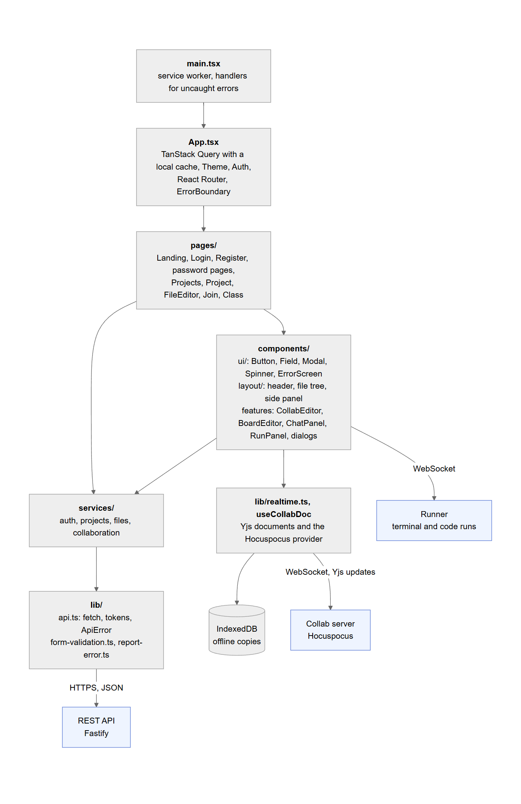
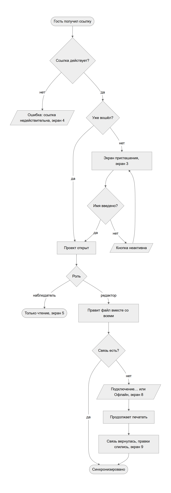

# Front end

The web client lives in [apps/web](../../apps/web). It is a single-page app: React 18 and TypeScript,
built by Vite. The browser loads one HTML page, and React Router changes the screens without a reload.

Live version: https://35-228-155-63.sslip.io

## How to run it

You need Node.js 20 or newer, pnpm and Docker (for Postgres and Redis). The full setup, with the
`.env` files, is in the main [README](../../README.md#running-it-locally). In short:

```
pnpm install
docker compose -f infra/docker-compose.dev.yml up -d
pnpm db:migrate
pnpm dev:api
pnpm dev:collab
pnpm dev:web
```

The app opens at http://localhost:5173. `pnpm dev:runner` is only needed to run code.

Checks for the front end only:

```
pnpm --filter @collab/web test        # unit and component tests (Vitest)
pnpm --filter @collab/web typecheck
pnpm --filter @collab/web build       # production bundle in apps/web/dist
pnpm --filter @collab/e2e e2e         # end-to-end tests (Playwright)
```

## Architecture



Source of the diagram: [diagrams/architecture.mmd](diagrams/architecture.mmd).

The code goes in one direction: pages use components and services, services use the API client,
and nothing in `components/` calls `fetch` itself.

- `main.tsx` starts the service worker (the app works offline as a PWA) and listens for errors that
  nobody caught.
- `App.tsx` puts the providers around the app (TanStack Query, theme, auth), sets the routes and wraps
  them in an `ErrorBoundary`. Project pages sit behind `ProtectedRoute`.
- Data from the REST API goes through TanStack Query. The cache is kept in `localStorage`, so the list
  of projects and files opens even without a connection.
- The text of files and boards is not loaded by REST. It is a Yjs document that syncs over a WebSocket
  with the collab server, and a copy is kept in IndexedDB for offline work.

## Folder structure

| Folder | What is in it |
|---|---|
| [src/pages](../../apps/web/src/pages) | One file per screen: `LandingPage`, `LoginPage`, `RegisterPage`, `PasswordPages`, `ProjectsPage`, `ProjectPage`, `FileEditorPage`, `JoinPage`, `ClassPage`, `ClassJoinPage`, `PrivacyPage`, `TermsPage` |
| [src/components/ui](../../apps/web/src/components/ui) | Small building blocks with no business logic: `Button`, `Field`, `Modal`, `Spinner`, `ErrorScreen`, `Avatar`, `Segmented` |
| [src/components/layout](../../apps/web/src/components/layout) | The frame of the project screen: header, file tree, side panel, menus |
| [src/components](../../apps/web/src/components) | Feature components: `CollabEditor`, `BoardEditor`, `ChatPanel`, `RunPanel`, `TerminalPanel` and the dialogs |
| [src/services](../../apps/web/src/services) | All calls to the API, grouped by topic: `auth.service.ts`, `projects.service.ts`, `files.service.ts`, `collaboration.service.ts` |
| [src/lib](../../apps/web/src/lib) | The API client (`api.ts`), auth and theme contexts, form validation, error reporting, real-time helpers and small pure functions |
| [src/test](../../apps/web/src/test) | Test setup and a helper that renders a page with the router, query client and theme |

## User flows

The three main flows are drawn in the UX specification. Each step points to a screen of the app.

1. Join a project by link, as a guest or with an account:
   [flow-1-join](../ux/img/flow-1-join.png)
2. Start a new project and invite people:
   [flow-2-start](../ux/img/flow-2-start.png)
3. Run code and share the result:
   [flow-3-run](../ux/img/flow-3-run.png)



The full specification with all screens and error states is
[docs/ux/UX_Harminovich_Artsiom.pdf](../ux/UX_Harminovich_Artsiom.pdf).

## Why this stack

| Choice | Why |
|---|---|
| React 18 | The editor parts I needed already exist for React: Monaco (`@monaco-editor/react`), the canvas for the board (`react-konva`) and Yjs bindings. Hooks fit well with live data that changes all the time. |
| Vite | Very fast start and reload in development, a small production bundle, and a PWA plugin for offline work. Monaco and the web workers build without extra setup. |
| TypeScript | The front end, the API and the collab server share types and Zod schemas from `packages/shared`, so a change in the API breaks the build, not the user. |
| TanStack Query | Gives loading, error and cached states for every request, and can keep the cache between visits. I did not have to write this by hand. |
| React Router 6 | Nested routes match the screen: a project page with the file inside it (`/projects/:id/files/:fileId`). |
| Tailwind CSS | Colours are CSS variables, so the light and dark themes are one set of classes. |
| Yjs + Hocuspocus | The real-time part. Why CRDT and not OT is in [ADR 005](../adr/005-crdt-not-ot.md). |
| Zod | The same schemas check a form in the browser and the request on the server, so the rules never drift apart. |
| Vitest + Testing Library, Playwright | Vitest uses the same Vite config. Testing Library tests what the user sees. Playwright can open several browsers at once, which I need to test two people editing together. |

## Where each requirement is

### Forms and validation

- The rules come from the shared Zod schemas (`loginSchema`, `registerSchema`, `forgotPasswordSchema`,
  `resetPasswordSchema`, `upgradeGuestSchema` in `packages/shared`).
- [lib/form-validation.ts](../../apps/web/src/lib/form-validation.ts) turns a schema into field errors
  with friendly messages. An error appears after the first submit and goes away as soon as the field is
  fixed.
- [components/ui/Field.tsx](../../apps/web/src/components/ui/Field.tsx) shows the error under the field,
  with a red border, `aria-invalid` and `aria-describedby` for screen readers.
- Used in `LoginPage`, `RegisterPage`, `PasswordPages`, `UpgradeGuestDialog`. `CreateFileDialog` and
  `RenameFileDialog` check the file name while you type: taken names and paths like `../x` are refused
  before anything is sent.
- An error from the server (for example "This email is already registered") is shown above the form,
  and what the user typed stays in the fields.

### Global error handling

- [components/ErrorBoundary.tsx](../../apps/web/src/components/ErrorBoundary.tsx) catches a crash in any
  page, shows a calm error screen with "Try again" and "To my projects", and sends the error to the
  server.
- [lib/report-error.ts](../../apps/web/src/lib/report-error.ts) also listens for `error` and
  `unhandledrejection` on `window`. Reports go to `POST /client-errors`, at most 10 per page and without
  repeats.
- [lib/api.ts](../../apps/web/src/lib/api.ts) turns every failed request into an `ApiError` with a
  message a person can read. When the access token runs out, it renews it once and repeats the request;
  if that fails, the user is asked to sign in again.
- Pages that cannot load their data show `ErrorScreen` (for example a project you were removed from).

### Loading states

- Buttons change their text and turn off while a request runs ("Signing in…", "Creating…", "Sending…"),
  so a form can't be sent twice.
- Pages and panels show `Spinner` or `FullScreenLoader` while the first data loads.
- The project header shows the connection: "Connecting…", "Offline: edits are saved on this device",
  and the chat has its own notice.

## Tests

Component tests (Vitest, Testing Library, jsdom). Each one renders a real component and acts like a
user:

| Test | What it checks |
|---|---|
| [LoginPage.test.tsx](../../apps/web/src/pages/LoginPage.test.tsx) | Field errors on an empty form, the error goes away when fixed, loading state, server error, link to password reset |
| [RegisterPage.test.tsx](../../apps/web/src/pages/RegisterPage.test.tsx) | Same rules as the server, the name is trimmed, a taken email keeps the typed data |
| [CreateFileDialog.test.tsx](../../apps/web/src/components/CreateFileDialog.test.tsx) | Taken names and unsafe paths are refused at once, the file type is passed on, a server error keeps the dialog open |
| [ErrorBoundary.test.tsx](../../apps/web/src/components/ErrorBoundary.test.tsx) | A crash shows the error screen and is reported |
| [VerifyEmailBanner.test.tsx](../../apps/web/src/components/VerifyEmailBanner.test.tsx) | When the banner shows, the sending state, the server's error message |

There are also unit tests for the pure logic in `src/lib` (file tree, tabs, fuzzy search, token expiry
and more), about 100 front-end tests in total.

End-to-end tests (Playwright, [e2e/tests](../../e2e/tests)) run the whole system in real browsers. The
main ones for the front end:

- `collaboration.spec.ts`: "two people edit one file and see each other's changes live"
- `classroom.spec.ts`: "a teacher starts a class, a guest student gets their own copy, and the teacher
  sees them"
- `teamwork.spec.ts`: "a viewer is offered no invitation and a failed file creation stays in the dialog"
  and "edits made without a connection are merged after it returns"

All tests, lint and typecheck run in GitHub Actions on every push.
