# 2 Design

## 2.1 Requirements

### 2.1.1 Functional requirements

1. Several users edit one file at the same time, with syntax highlighting and visible cursors of the
   participants.
2. Projects, a file tree, and inviting participants by a link (also as a guest without an account) and by
   email.
3. Three file types: code (the Monaco editor), a Markdown document with a preview, and a design board
   (shapes, text, arrows, participants' cursors, export to PNG and SVG). Collaboration and offline mode
   work for all three types.
4. A project chat and a presence indicator.
5. Project roles: owner (`owner`), editor (`editor`), viewer (`viewer`); rights are checked on the server.
6. Working without a connection: edits are kept locally and merge automatically on reconnect.
7. Running JavaScript and Python on the server, with output shared by all participants and the error line
   highlighted, as a helper feature.
8. Helper features added during implementation: a terminal in an isolated container (section 3.6),
   importing a public GitHub repository and pushing changes to it as a commit, switching repository
   branches (section 3.8).

### 2.1.2 Non-functional requirements

- a responsive interface from a phone to a desktop;
- isolation of the code that runs (network, file system, privileges, resources);
- a documented REST API (OpenAPI/Swagger) and a described WebSocket protocol;
- deployment in the cloud, a reproducible build and CI.

### 2.1.3 What is deliberately out of scope

A step-by-step debugger, a full Git client (merging, pulling other people's changes from the repository,
deleting and renaming files there), voice and video calls, advanced design tools (pen, components,
auto-layout, prototyping). Voice and video are left out because they are a separate large subsystem
(WebRTC, a signalling server, STUN/TURN) that has nothing to do with the research question and does not
fit into the time for the work.

### 2.1.4 Complexity criteria

Table 2.1 shows how the work meets the complexity criteria.

Table 2.1. Complexity criteria

| Criterion | Covered by |
|---|---|
| Back-end / Front-end | Node.js: REST API, sync server, run queue worker; React SPA |
| Adaptive UI | Tailwind layout from phone to desktop, Markdown preview, board |
| Database | PostgreSQL, Prisma migrations (see `docs/db`) |
| Cloud | Google Cloud (Compute Engine) in practice; an AWS design (EC2, RDS, S3, CloudFront) is described |
| API documentation | OpenAPI/Swagger for REST, WebSocket protocols described in `docs/` |

## 2.2 Architecture

The system consists of a client application, three server services on Node.js and two stores
(table 2.2); figure 2.1 shows how they are connected.

Table 2.2. System components

| Component | Purpose |
|---|---|
| `web` | React SPA: editors (Monaco, board on Konva), chat, project management; PWA |
| `api` | REST (Fastify), auth, projects, files, chat, invitations; WebSocket `/ws` for project events |
| `collab` | WebSocket server for document sync (Hocuspocus/Yjs), access checks, storing snapshots |
| `runner` | Queue worker (BullMQ): runs code in isolated Docker containers; terminal server (WebSocket) |
| PostgreSQL | Users, projects, members, files (Yjs snapshots), file versions, messages |
| Redis | Run job queue and the output event channel |

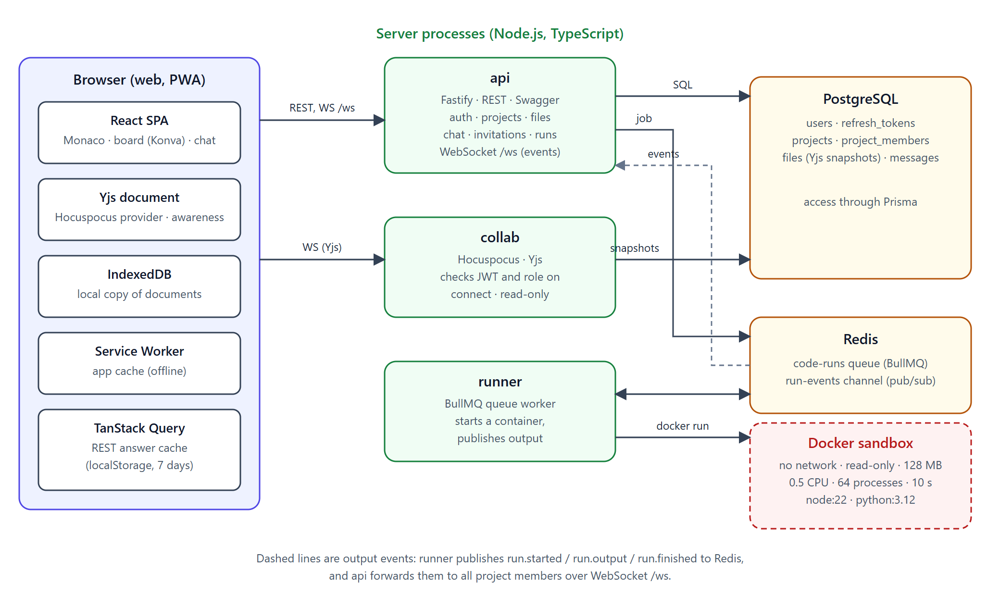

Figure 2.1. System components and how they are connected

Data flows (figures 2.2 and 2.3 show the exchange when a file is opened and when code is run):

- **Metadata** (projects, file list, roles) goes through REST and is cached on the client (TanStack Query,
  saved to localStorage).
- **File content** goes over WebSocket to `collab`: one Yjs document per file. The client keeps a local
  copy in IndexedDB, so files opened before are available offline.
- **Chat** is not a CRDT: messages are written to PostgreSQL through REST and sent out as an event over
  the `/ws` WebSocket. The history has to be paged, and in Yjs it would grow without limit.
- **Running code**: `api` puts a job into the queue, `runner` runs it in a container and publishes the
  output to Redis, and `api` forwards the events to the project members over `/ws`.

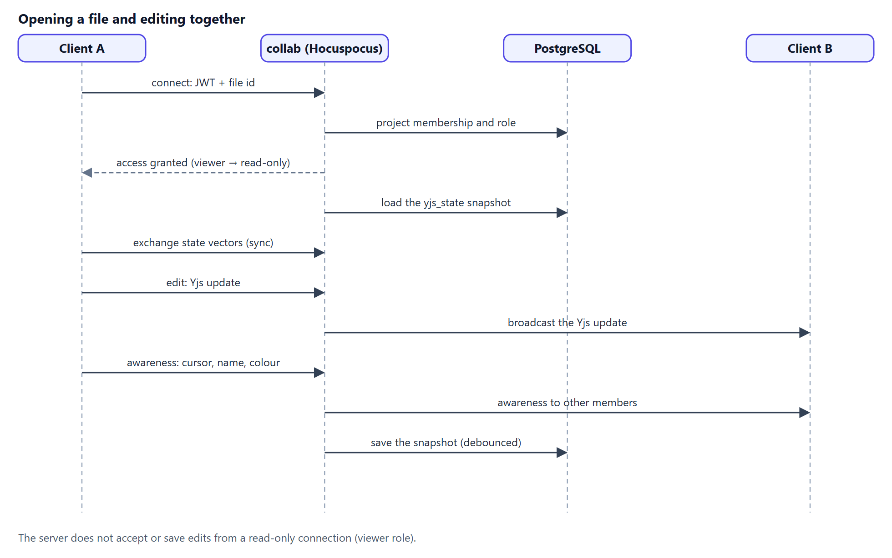

Figure 2.2. Connecting to a document: access check, loading the snapshot, exchanging edits and cursors

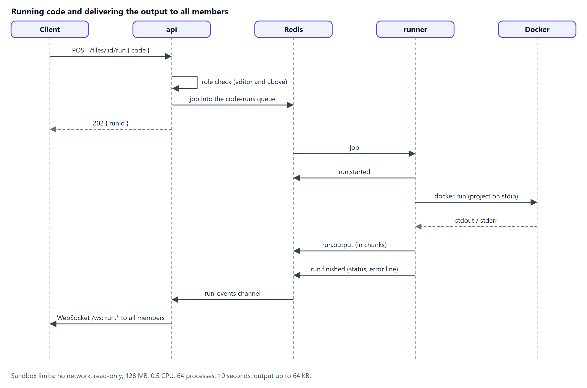

Figure 2.3. Running code: the queue, the sandbox and delivering the output to all project members

The architecture decisions are recorded as ADRs (folder `docs/adr`):

- **ADR-001**: one Yjs document per file; the file tree is stored in PostgreSQL. As a result, files opened
  on this device before are available offline, and renaming and deleting files offline is not synced.
- **ADR-002**: sync through Hocuspocus as a separate service (ready-made hooks for auth and storage
  instead of an own protocol, which would take several weeks).
- **ADR-003**: running code in Docker through a queue; the limit values were chosen during
  implementation (see section 3.6).
- **ADR-004**: one EC2 instance with Docker Compose, the database in RDS, the client app in S3 behind
  CloudFront; ECS as the way to grow. In practice the live site runs on one Google Cloud VM with the
  same Docker Compose approach.
- **ADR-005**: a CRDT rather than OT, because offline editing is built in.

## 2.3 Data model

The data is stored in seven PostgreSQL tables (table 2.3); file content is stored not as text but as a
binary Yjs snapshot. Figure 2.4 shows the relations between the main tables; it does not show every
column: `users` has no `created_at` there, `refresh_tokens` has no `created_at`, `projects` has no GitHub
columns, `files` has no `branch`, `source_sha`, `deleted_at`, `trashed_path`, and the `file_versions`
table is left out. The full diagram and the data dictionary are in `docs/db`.

Table 2.3. Database tables

| Table | Key columns | Relations |
|---|---|---|
| `users` | id, email, name, password_hash, **is_guest**, created_at | — |
| `refresh_tokens` | id, user_id, token_hash, expires_at, created_at | → users |
| `projects` | id, name, owner_id, **invite_code**, **invite_role**, **github_owner**, **github_repo**, **github_branch**, created_at | → users |
| `project_members` | project_id, user_id, role (owner / editor / viewer) | → projects, users |
| `files` | id, project_id, **branch**, path, type (code / doc / board), language, yjs_state (bytea), **source_sha**, updated_at, **deleted_at**, **trashed_path** | → projects |
| **`file_versions`** | id, file_id, content, size, author_id, created_at | → files, users |
| `messages` | id, project_id, author_id, body, created_at | → projects, users |

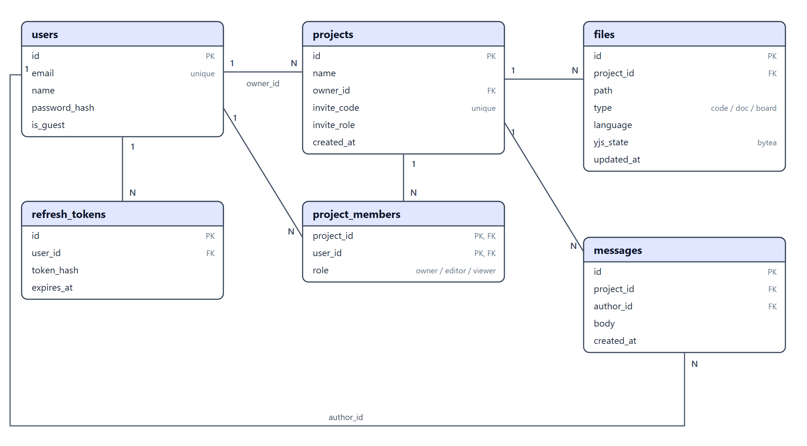

Figure 2.4. PostgreSQL tables and their relations

The columns in bold were added during implementation. `is_guest`, `invite_code` and `invite_role` serve
invitations: an invite link works like an invite link to a Discord server: anyone who has it gets into
the project with the given role, and guest entry creates a throwaway account without a real email or
password (a technical address like `guest-…@guest.local` and a random password that nobody is told). The
`github_*`, `branch` and `source_sha` columns are needed for the GitHub link and branches (section 3.8),
`deleted_at` and `trashed_path` for the trash (section 3.9), and `file_versions` for the version history;
the uniqueness of a file path is checked within the triple "project, branch, path". Code run results are
not stored: they live in Redis until the job ends and are sent to subscribers.

### 2.3.1 Auth and rights

Signing in gives a pair of tokens: a short-lived access token (JWT) and a refresh token, an opaque random
string of which the database stores only a hash; the refresh token is rotated on every refresh. Passwords
are hashed with argon2id. Rights are checked on the server for every request: a user who is not in a
project gets "not found" (not "forbidden"), so the existence of the project is not revealed. `collab` runs
the same checks when a document is connected, and for the `viewer` role the connection is marked
read-only: the server does not accept or save edits from it.

## 2.4 Offline mode

Offline work relies on two things: the service worker caches the app itself (with the Monaco editor), and
`y-indexeddb` keeps a local copy of each open file. When a file opens, the document is first loaded from
IndexedDB and then synced with the server. Without a network, edits are written only locally and the
indicator shows "offline". On reconnect, the client and the server exchange state vectors and send only
what is missing; the CRDT merges the edits without conflicts.

What does **not** work offline: the chat, running code, creating and renaming files, and files never
opened on this device.

## 2.5 Interface

**Principles.** The interface follows the familiar Discord model: a project is a "server", files are
"channels". On the left there is a narrow column of projects (quick switching) and the file list next to
it; the work area is in the middle; the "Chat" and "Members" tabs are on the right. Rare actions don't take
screen space: like the server menu in Discord, the project name opens them (invite people, branch, search
text, import and push to GitHub, ZIP archive, your role), and at the bottom of the file list there is the
user card. The header of the work area shows the file name with a sync icon, action icons (mention a line,
history, terminal), one labelled "Run" button that becomes "Stop" while the program runs, and the avatars
of the people in the project now. The run output is a collapsible panel shared by all participants. A
`viewer` sees the editor in read-only mode with a mark in the header. The board can be used without a
mouse: a tool button pressed from the keyboard adds a shape, the arrows move it, and square brackets
select shapes.

**Visual language.** The dark theme by default and a light one on request (the choice is remembered;
before the first paint a script in `index.html` applies the theme, so the page does not flash the other
theme while loading). Colours are tokens (CSS variables) used both by Tailwind classes and by the Monaco
editor themes; the fonts (Inter and JetBrains Mono) ship with the app and work offline. A participant's
colour is the same everywhere: the avatar and the cursor in the editor and on the board are chosen from
the user id by one function.

**Sizes.** Discord is the reference: the interface follows its model, and the first version with 14 and
10–12 px text turned out too small to work with. Now 16 px is for what people read (file names, messages,
inputs, main buttons), 14 px for what goes with it (hints, panel buttons), 12 px for labels and times; no
text is smaller (scenario 40 in section 5.2). A file list row is 34 px, buttons are 32, 40 and 44 px high,
the project column is 72 px, and avatars in the chat and the member list are 32 px. Code in the editor and
the terminal is 15 px. The font stayed Inter: Discord's font (gg sans) is not freely licensed. The header
of the work area chooses which labels to show by its own width, not the window's (CSS container queries):
next to open panels it is narrow even on a big screen.

**Scenarios.** Sign-in: a product showcase on the left, the form on the right; "Continue as guest" is the
second most important button. Home: project cards and a "paste an invite link" field. Import: a GitHub
repository is pasted as a link, into an empty project or when creating a new one (section 3.8). New file:
a dialog with a choice of type (code, document, board) and a name check. Invitation: a dialog with the
link, the role for the link and invitation by email. Empty project: a hint with three quick actions.

**Invited user.** An invite link opens not the sign-in form but a page "Artem invites you to the project
'…'" with the role the person will get; a guest enters a name and joins with one button, and for people
with an account there are "Sign in" and "create one" links next to it. The name can be changed later in
the profile menu. Server error messages are written in plain language, and a project that does not exist
or is not available shows a separate page with an explanation instead of endless loading.

**Working with files.** Files are shown as a folder tree; Ctrl+P (or the "Find a file" button) opens quick
navigation by part of the name, and a file can be renamed or moved into a folder. Deleting moves a file to
the project trash, from where any editor can restore it, and only the owner can delete it for good. Open
files stay as tabs. Before pushing to GitHub, a list of changes is shown. A project with files opens right
away on the last opened file (or the README), and the browser tab title shows the file name. The owner
changes members' roles and removes them from the project.

**Responsive layout.** On screens narrower than 1024 px the project and file columns move into a sliding
menu; below 1280 px the chat and members open over the work area; a Markdown document on a narrow screen
shows the editor and the preview one under the other. Animations are turned off with
`prefers-reduced-motion`.

**Accessibility.** Controls have text labels (`aria-label`), dialogs close with Escape and return the
focus, and a visible focus outline is set for all interactive elements. Contrast was not checked with
special tools.

The main screens are shown in figures 2.5–2.14.

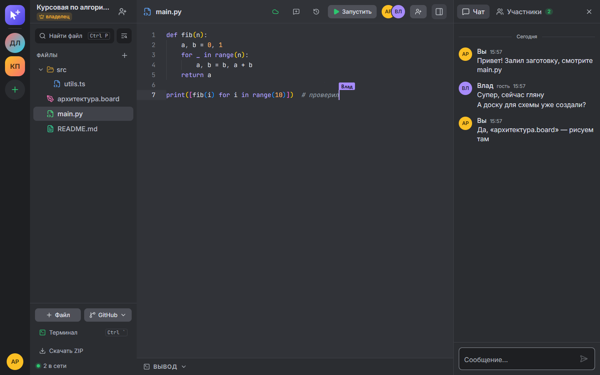

Figure 2.5. Code editor: another participant's cursor, chat and presence

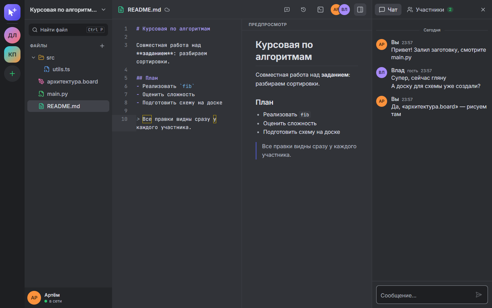

Figure 2.6. Markdown document with a preview

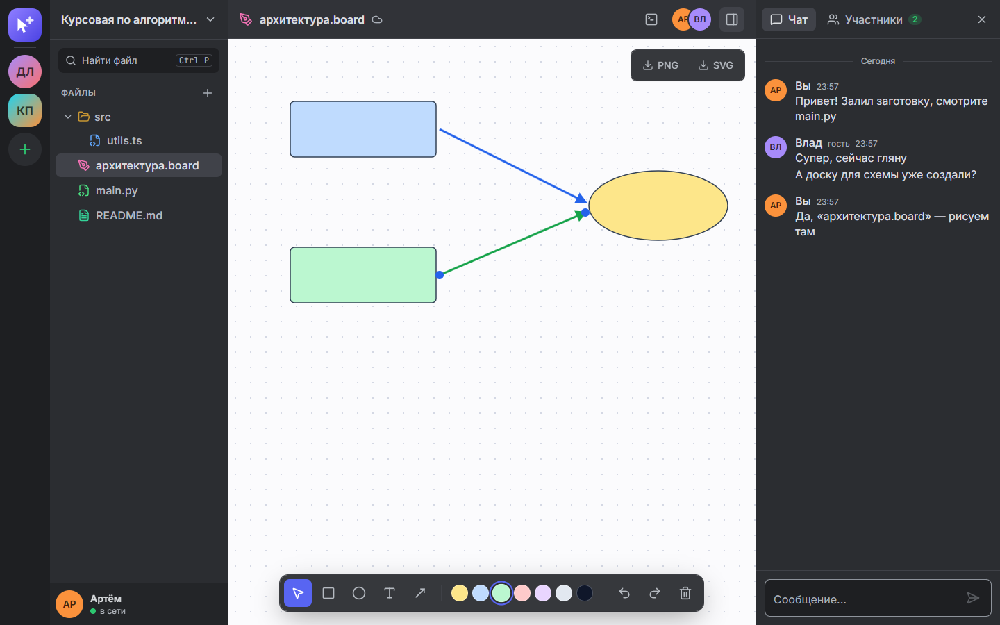

Figure 2.7. Design board

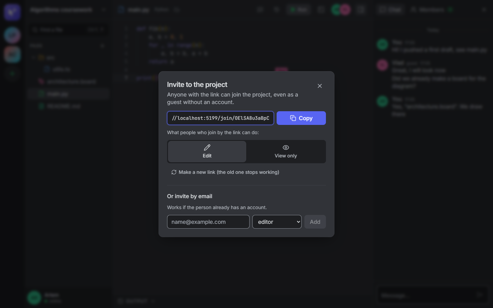

Figure 2.8. Invite dialog

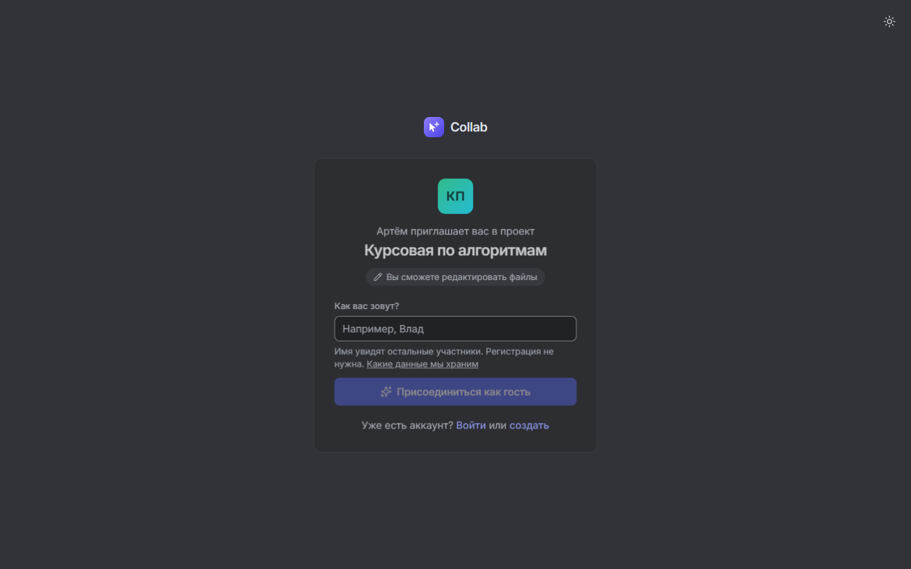

Figure 2.9. The page an invite link opens

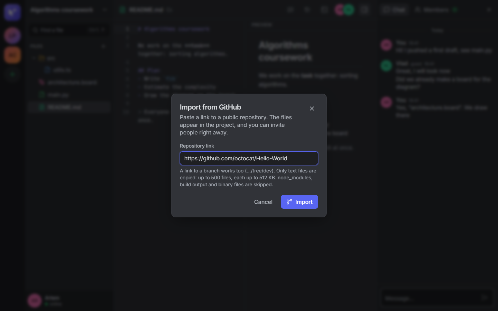

Figure 2.10. Importing a project from GitHub

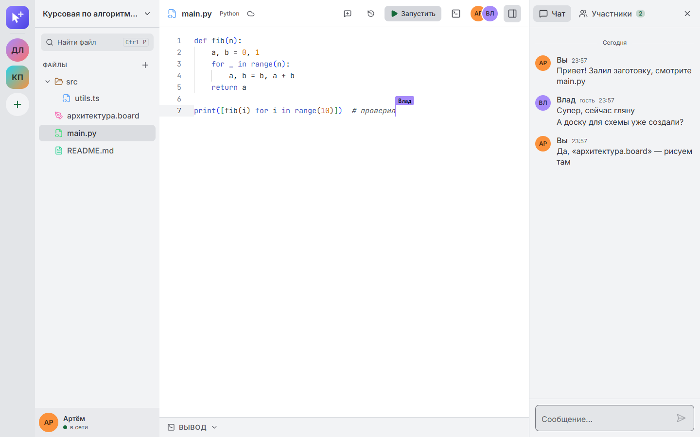

Figure 2.11. Light theme

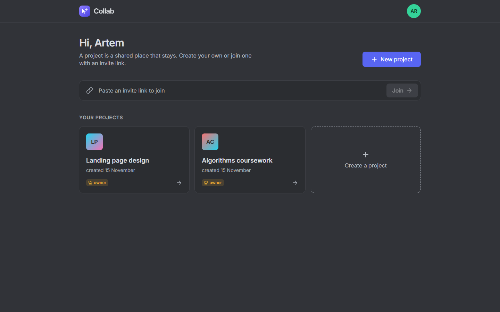

Figure 2.12. Home page with the project list

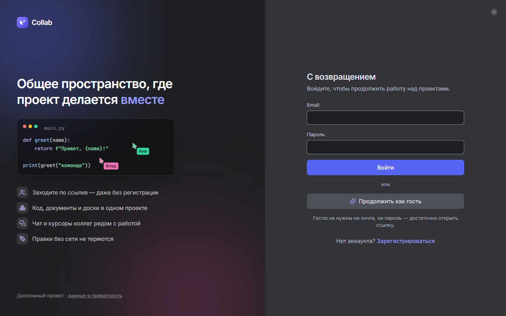

Figure 2.13. Sign-in page

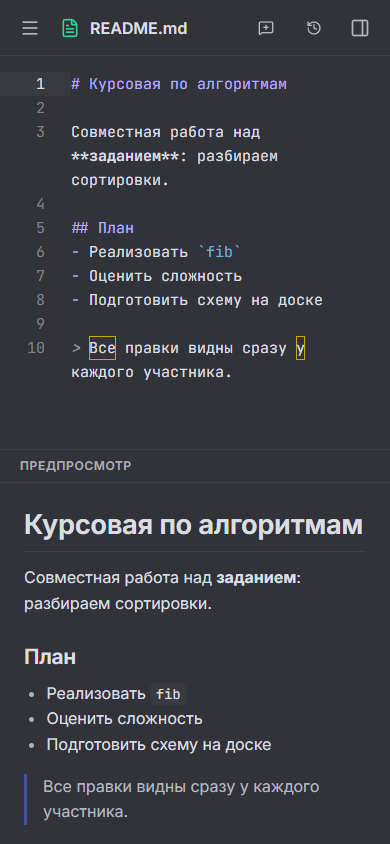

Figure 2.14. The interface on a phone screen

The screenshots are made automatically by an end-to-end test
(`SCREENSHOTS=1 pnpm --filter @collab/e2e e2e screenshots`), so they can be refreshed after any change to
the interface.

## 2.6 Repository structure

A pnpm workspaces monorepo: `apps/{web,api,collab,runner}`, `packages/{shared,db}`, `bench/` (the research
bench), `infra/`, `docs/`. Shared types and validation schemas (Zod) live in `packages/shared` and are used
by both the server and the client, so the contract between them is checked by the compiler.
