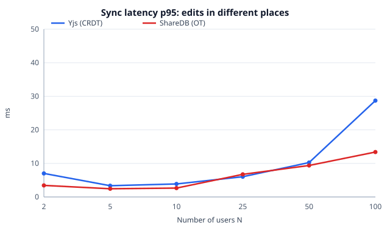
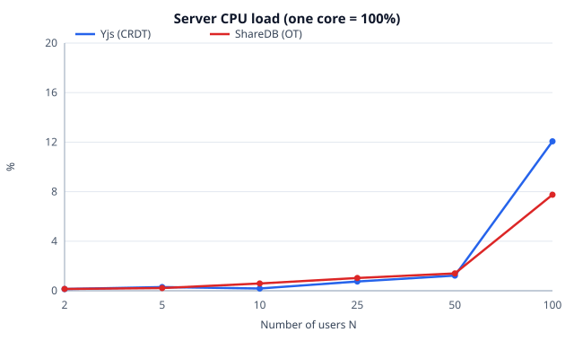
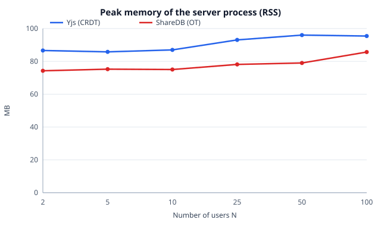
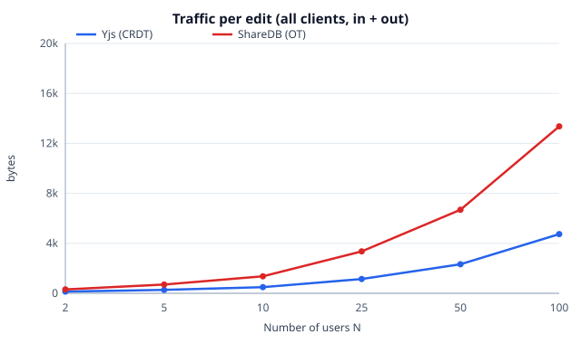
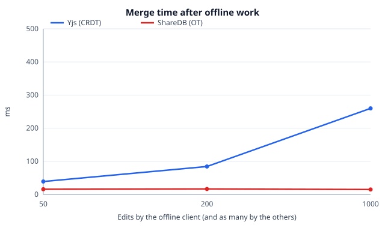
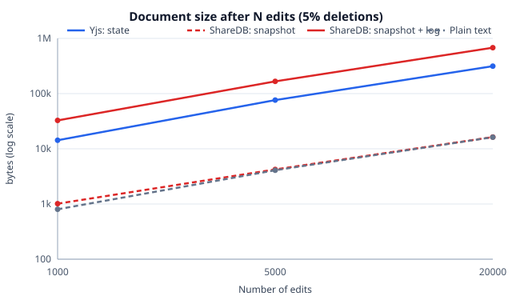
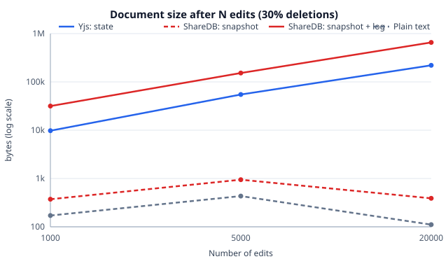
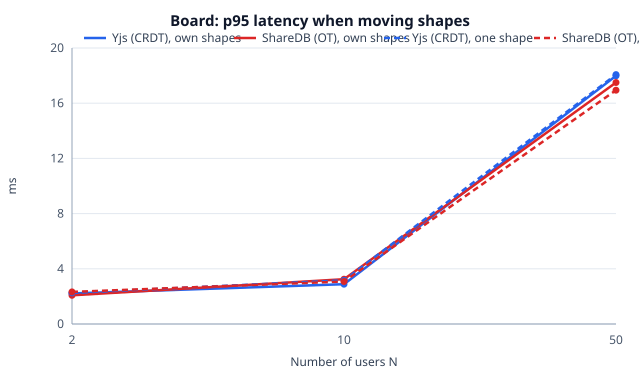

# 4 Research: CRDT vs OT

## 4.1 The question

**Question.** Which approach, CRDT or OT, suits collaborative code editing better in terms of latency,
correctness and scalability, especially for offline work?

**Working hypothesis.** A CRDT gives a comparable latency with a small number of users and wins in offline
scenarios, but loses on document size and memory.

**Systems compared.**

- CRDT: Yjs [8], the Hocuspocus server [10] (the same as in the platform, without a database);
- OT: ShareDB [3] with the `json0` type [4] (text through the `text0` subtype), in-memory storage.

Both systems run without a storage layer: the sync algorithm and its server are compared, not the
database. The bench is in the `bench/` folder; the full results are in `bench/results/REPORT.md` and
`bench/results/latest.json`.

## 4.2 Method

**Bench.** The server of each system is a separate Node.js process, so its CPU and memory can be measured
apart from the clients. Each client ("bot") is a real client of its system (`HocuspocusProvider` with a
`Y.Doc`, or a `ShareDB.Connection`) with its own WebSocket connection. In the typing scenario the bots are
spread over separate processes (up to 12 clients per process, at most 8 processes; at N = 100, 12–13
clients each); in the other scenarios all clients run in the bench's main process. Latency is measured from
the insert call at the author to the edit appearing at another client, using the machine's shared clock.
All edits are inserts of unique tokens like `<c012.45>`: they make it possible to check that no edit is
lost and to match sending with receiving exactly.

**Bench check.** For each run, the event loop lag (p99) in the bot processes is recorded; a point counts as
valid if it is below 100 ms. The background value on this machine is about 20–25 ms (Windows timer
granularity). The maximum over all 72 typing runs is 32 ms.

**Scenarios.**

1. *Typing at the same time:* N ∈ {2, 5, 10, 25, 50, 100} users, each inserting a token on average once a
   second (exponential intervals), for 10 s. Two modes: edits at random token boundaries ("different
   places") and everyone inserting at position 0 ("same position", the most conflicts).
2. *Offline:* five clients; one disconnects and makes K edits locally (K ∈ {50, 200, 1000}), while the
   others make another K; then the client comes back. Merge time is from the reconnect until everyone has
   the same text.
3. *Document growth (one run per point):* five clients make 1000 / 5000 / 20000 edits (inserting a
   character or deleting 1–5 characters) with 5% and 30% deletions; the document size is measured.
4. *Board:* N ∈ {2, 10, 50} clients move shapes (5 moves per second per client, for 8 s) in two modes: each
   their own shape / everyone the same one. This is another kind of CRDT (a map of registers instead of a
   sequence of characters) against the `oi`/`od` operations on an object in OT.

**Metrics.** Latency (mean, p50, p95, p99), correctness (the same text hash at all clients and all edits
present), CPU load and peak memory of the server process, traffic per edit (bytes sent and received by all
clients, divided by the number of edits), document size, merge time after offline work.

**Repeats.** Each point of scenarios 1, 2 and 4 is repeated 3 times; the tables show the mean, and the
range (minimum–maximum over the repeats) is given for p95 and the merge time. The random number generator
is deterministic (`mulberry32`), and the seed depends on the repeat number.

**Environment.** Windows 11, AMD Ryzen 7 5700U (16 threads), 14 GB RAM, Node.js 22. Servers and clients
run on one machine (loopback).

## 4.3 Results

In total there were 138 runs: 72 (typing), 18 (offline), 36 (board), 12 (document growth); the typing runs
made 23,498 edits.

### 4.3.1 Correctness

**In all 138 runs both systems converged to the same text (the same hashes at all clients), no edit was
lost, and every edit reached every receiver (100% delivery).** This holds for the mode with the most
conflicts (everyone inserting at the same position), for merging after offline work and for many clients
moving the same shape at once. There is no difference in correctness: both approaches solve the task.

### 4.3.2 Latency

Table 4.1 gives extracts from the results (details in `bench/results/REPORT.md`), and figure 4.1 shows p95
by the number of users.

Table 4.1. Edit delivery latency, ms (edits in different places of the document)

| N | Yjs p50 | ShareDB p50 | Yjs p95 | ShareDB p95 |
|---|---|---|---|---|
| 2 | 2.0 | 1.6 | 7.0 | 3.4 |
| 25 | 2.8 | 2.0 | 6.0 | 6.7 |
| 100 | 9.9 | 5.0 | 28.7 | 13.4 |

The "same position" mode shows the same picture: p50 of 9.6 and 5.1 ms at N = 100.

Both systems show latencies of a few milliseconds (p95 at most 10.3 ms on average over three repeats, up
to 12.3 ms in a single repeat) up to 50 users, and up to 29 ms (p95) at 100. Up to 50 users the values are
an order of magnitude below the threshold people notice when typing (about 100 ms), and at 100 users they
are 3–4 times below it. Up to 25 users the difference between the systems is a fraction of a millisecond
(ShareDB is faster by 0.4–0.8 ms on the median; on p95 Yjs is even faster at N = 25). At N = 100 Yjs is
about twice as slow (p95 of 28.7 against 13.4 ms) but stays far from noticeable values. The conflict mode
(same position) does not make the latency worse for either system.



Figure 4.1. p95 latency with edits in different places of the document

### 4.3.3 Server load and traffic

Figures 4.2–4.4 show CPU load, memory and traffic.

- **Server CPU** stays below 1.5% of one core for both systems up to N = 50 (mean over repeats); at
  N = 100 it is 12% (Yjs) and 8% (ShareDB). The load is comparable.
- **Server process memory (RSS):** Yjs uses 11–22% more at every N (for example, 87 against 74 MB at
  N = 2 and 95 against 86 MB at N = 100). The absolute difference is 10–17 MB.
- **Traffic per edit:** Yjs sends **2.2–2.9 times less** than ShareDB (141 against 311 bytes at N = 2;
  4743 against 13,360 at N = 100); in the "same position" mode, 2.4–3.3 times less. This is the opposite of
  the expected "CRDT is heavier": Yjs sends compact binary updates, ShareDB sends JSON messages with
  versions and acknowledgements. Traffic per edit grows linearly with N for both systems, as it should when
  every edit is sent to every participant.



Figure 4.2. CPU load of the server process



Figure 4.3. Peak memory (RSS) of the server process



Figure 4.4. Traffic per edit

### 4.3.4 Offline work

Table 4.2 and figure 4.5 show the merge time and traffic after offline work.

Table 4.2. Merging after offline work

| K edits | Yjs, merge ms (range) | ShareDB, merge ms (range) | Yjs, KB | ShareDB, KB |
|---|---|---|---|---|
| 50 | 39 (36–41) | 16 (15–16) | 16.0 | 5.6 |
| 200 | 84 (80–90) | 16 (16–17) | 67.3 | 16.8 |
| 1000 | 260 (239–301) | 15 (14–17) | 346.1 | 75.6 |

Both systems merged the edits without losses, but **ShareDB merges faster and almost independently of K,
while Yjs grows with K; Yjs's traffic during the merge is 2.9–4.6 times higher**. This does not confirm the
expectation that a CRDT wins the offline scenario on merge speed. A likely explanation (not tested
separately in this work): while there is no connection, the ShareDB client does not send operations one by
one but collects unacknowledged operations in a queue whose operations the library can combine (operation
composition), and the server transforms the result in a small number of steps; Yjs integrates each of the
~2K new elements at a position found through the chain of references and sends them as separate
structures. The advantage of a CRDT offline is not merge speed but the absence of an arbiter: merging does
not need the server to know the order and works in any topology (including when the server is not
available).



Figure 4.5. Merge time after offline work

### 4.3.5 Document size

It helps to split the size into two values: how many bytes a client needs to open the document ("to open")
and how much is stored in total. For Yjs these are the same: the whole state, tombstones included. For
ShareDB the client gets only the snapshot, and the operation log (from which any version can be rebuilt) is
kept on the server.

Table 4.3 gives the results for 5% deletions (typical typing), and figures 4.6 and 4.7 show how the size
depends on the number of edits for 5% and 30% deletions.

Table 4.3. Document size with 5% deletions

| Edits | Yjs: open = total, bytes | ShareDB: open, bytes | ShareDB: total, bytes | Text Yjs / ShareDB, bytes |
|---|---|---|---|---|
| 1,000 | 14,286 | 1,015 | 32,713 | 803 / 807 |
| 5,000 | 76,228 | 4,223 | 166,445 | 4,089 / 4,014 |
| 20,000 | 314,089 | 16,331 | 678,273 | 16,236 / 16,122 |

The conclusion has two sides. **To open a document, Yjs needs 14–19 times more bytes than the ShareDB
snapshot** (14,286 against 1,015 at 1000 edits; 314,089 against 16,331 at 20,000): the Yjs state includes
the identifiers of every inserted character and the tombstones. **But in total Yjs stores 2.2–2.3 times
less than ShareDB with its snapshot and log** (about 15 bytes per edit against 33). With 30% deletions the
text hardly grows (100–750 bytes), while Yjs grows with the number of edits (≈ 10–11 bytes per edit),
because tombstones are kept: at 20,000 edits the state is 220 KB for a text of 111 bytes, while the ShareDB
snapshot is 389 bytes. So for a heavily edited document the CRDT overhead is real and grows with the
history, not with the size of the text.



Figure 4.6. Document size with 5% deletions



Figure 4.7. Document size with 30% deletions

### 4.3.6 Design board

Figure 4.8 shows the latency when moving shapes.

The latency when moving shapes is the same for both systems within the range: p95 of about 2–3 ms at
N ≤ 10 and 17–18 ms at N = 50 (p50 of 6–7 ms); the "everyone moves one shape" mode is no different from
"each moves their own". In all runs the states of all clients matched. For moving shapes the choice of
algorithm makes practically no difference; the "map of registers" model is enough.



Figure 4.8. p95 latency when moving shapes on the board

### 4.3.7 A note on the limits of the bench

In trial runs with a typing speed of 2 edits/s per user and N = 100, Yjs showed a noticeably higher latency
than ShareDB, and the load of the bot processes suggested that the clients, not the server, had become the
bottleneck. So the main series was run at 1 edit/s, where the bench is not overloaded (the check is
described in section 4.2). The trial runs are not part of the main series, their data was not saved and
they were not repeated, so this is only an observation, not a result: it suggests that the Yjs client side
in Node.js costs more than the ShareDB client side at high intensity, but it needs a separate check. In a
browser each participant is a separate process, so this matters less in real use.

## 4.4 Checking the hypothesis

Table 4.4 compares the hypothesis with the results.

Table 4.4. Checking the working hypothesis

| Claim of the hypothesis | Result |
|---|---|
| Comparable latency with a small number of users | **Confirmed.** Up to 25 users the difference in medians is a fraction of a millisecond; both systems are an order of magnitude below the noticeable threshold |
| A CRDT wins in offline scenarios | **Not confirmed on merge speed:** ShareDB is faster (15–16 ms against 39–260 ms) and sends less traffic. Correctness is the same. The advantage of a CRDT is architectural (no arbiter), not speed |
| A CRDT loses on document size | **Partly confirmed:** the state a client needs to open the document is 14–19 times bigger and grows with the edit history; in total, though, Yjs storage is 2.2–2.3 times more compact than ShareDB with its log |
| A CRDT loses on memory | **Confirmed, the effect is small:** server RSS is 11–22% higher (10–17 MB) |
| (not in the hypothesis) traffic | Yjs sends 2.2–2.9 times less per edit |

## 4.5 Threats to validity

- **One machine, loopback.** There is no real network with delay and packet loss; absolute latencies in
  real use will be higher, and the differences between the systems will be set mainly by the network.
- **Clients in Node.js, not in browsers.** The cost of client-side processing in a browser is different; in
  the main series the load generator was not the bottleneck (event loop lag at most 32 ms), but absolute
  client-side costs do not carry over directly.
- **Servers without a database.** The algorithm is compared, not the full stack; in the platform Yjs also
  saves a snapshot to PostgreSQL.
- **Edits are inserts of 8–10-character tokens**, not typing character by character; this makes checking
  integrity easier but makes an edit bigger than a real one.
- **One typing speed** (1 edit/s per user) and one document; very large documents (hundreds of kilobytes of
  text) and intensive peaks were not studied.
- **One OT implementation** (`json0`/`text0`). Other types (`ot-text`, `rich-text`) and other servers could
  behave differently; the explanation of the difference in merging after offline work is an assumption,
  and checking it is left for further work.
- **The ShareDB log is stored** in process memory; the log size reflects the amount of data, not a
  particular format on disk.

## 4.6 Reproducing

```bash
pnpm --filter @collab/bench bench          # full set (≈ 30 minutes)
pnpm --filter @collab/bench bench:quick    # quick check (≈ 2 minutes)
```

The results are written to `bench/results/` (`latest.json`, `REPORT.md`, `charts/*.svg`). The typing speed
is set with the `EDITS_PER_SECOND` variable. The bench tests (`bench/src/scenarios.test.ts`) check that both
systems converge in all scenarios at small sizes.
